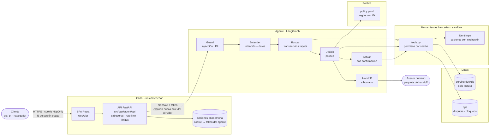
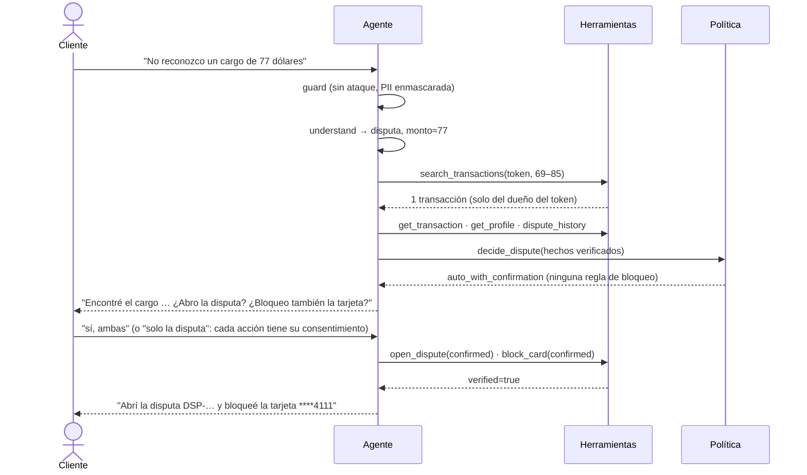
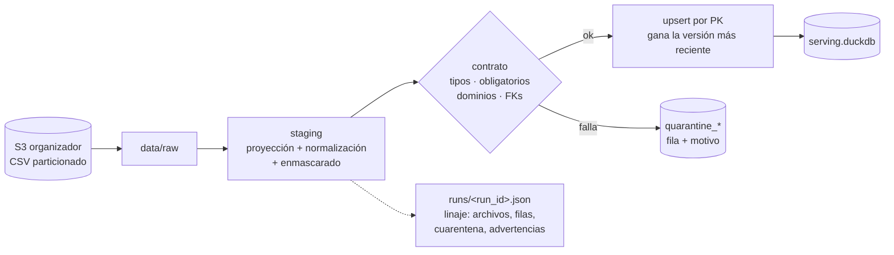
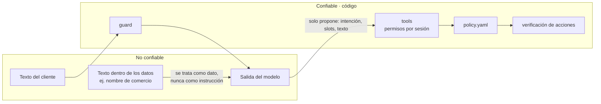

# Arquitectura

> Un agente de disputas de cargos no reconocidos. **El modelo interpreta y redacta; el código decide y actúa.**

> Cómo se operaría en producción (topología, capacidad, monitoreo, acceso, retención, runbook): [`operations.md`](operations.md).

## 1. Vista general: canal web + 4 capas



| Capa | Qué hace | Por qué así |
|---|---|---|
| Canal (web) | SPA + API en un proceso: login simulado, conversación, traza y consola del asesor; cookie HttpOnly/SameSite=Strict, CSP estricta, límites de tamaño y de ritmo | El navegador nunca tiene el token; la ingeniería (traza, reglas, handoff) queda visible ([ADR 0008](adr/0008-frontend-web.md)) |
| Datos | Contrato por tabla, cuarentena, upsert incremental, linaje | Reproducible y auditable; los problemas se reportan, no se ocultan |
| Herramientas | Única puerta a los datos; derivan el cliente del token | Los permisos no dependen del prompt |
| Política | Reglas declarativas y versionadas | El modelo nunca decide la elegibilidad |
| Agente | Orquesta pasos explícitos | Cada transición está declarada y queda trazada |

## 2. Quién decide qué

| Decisión | Responsable | Tipo |
|---|---|---|
| ¿La sesión es válida? ¿El dato es suyo? | `identity.py` + `tools.py` | Código |
| ¿El mensaje es un ataque? | `guard.py` (`InjectionDetector`) | Patrones (default) · clasificador ONNX opt-in, evaluado en [ADR 0005](adr/0005-deteccion-inyeccion.md) |
| ¿Qué quiere el cliente? | `Router` (interfaz) | Reglas (línea base) · LLM · otro modelo |
| ¿Cuál es la transacción? | `search_transactions` + aclaración | Código; pregunta si hay más de una |
| ¿Procede la disputa o va a un humano? | `policy.yaml` | Reglas con ID |
| ¿Ejecutar la acción? | Cliente (confirmación) + `tools.py` (verificación) | Humano + código |
| ¿Cómo se dice? | `Writer` | Plantillas (línea base) · LLM + verificador determinista ([ADR 0004](adr/0004-llm-acotado-router-writer.md)) |

## 3. El grafo

Generado desde el código (`Agent.mermaid()`); cada nodo solo puede ir a los destinos declarados en `EDGES`.

```mermaid
flowchart TD
    START([inicio]) --> guard
    guard -->|sesión inválida / ataque| respond
    guard -->|3 intentos bloqueados| handoff
    guard --> understand
    understand -->|"sí" a acción pendiente (por acción)| act
    understand -->|confirmación ambigua 2 veces| handoff
    understand -->|"no"| cancel
    understand -->|elige opción| select_option
    understand -->|disputa| find_transaction
    understand -->|bloqueo| find_card
    understand -->|fuera de alcance · pide humano · toma de cuenta · cancelar disputa| handoff
    understand -->|"¿en qué va mi disputa?"| check_dispute
    understand -->|poca confianza · "gracias" · "ninguna de esas"| respond
    understand -->|3 aclaraciones seguidas| handoff
    find_transaction -->|1 candidata| decide
    find_transaction -->|0 o varias: pregunta| respond
    find_transaction -->|herramienta caída · 3 aclaraciones| handoff
    select_option --> decide
    select_option -->|3 aclaraciones| handoff
    check_dispute -->|disputa verificada del cliente| respond
    check_dispute -->|no encontrada| handoff
    find_card --> respond
    decide -->|regla handoff| handoff
    decide -->|rechazo / pedir confirmación| respond
    act -->|verificado| respond
    act -->|no verificado| handoff
    cancel --> respond
    handoff --> respond
    respond --> END([fin del turno])
```

El estado persiste entre turnos (checkpointer por conversación). Así funcionan las aclaraciones ("¿cuál de estas?") y las confirmaciones ("¿confirmas?"). Dos reglas acotan ese estado (#31): una confirmación solo vale en el turno **inmediatamente** posterior a la pregunta (si en medio hubo otro turno, se descarta), y la conversación queda atada al cliente de su primer turno autenticado (la sesión de otro cliente recibe `forbidden`). Todos los caminos posibles del grafo están en [`graph-paths.md`](graph-paths.md).

**Handoff (#44).** El paquete es un caso listo para el asesor, versionado (`handoff/v1`, [`handoff.schema.json`](handoff.schema.json)): `handoff_id` que el cliente recibe en su idioma y que queda en el log de auditoría, cola/prioridad/SLA/siguiente paso y preguntas abiertas por motivo desde `policy.yaml`, lo que el cliente reclamó (`customer_claim`) frente a lo verificado (`match`), hechos con lista blanca de campos y la herramienta que falló (`failures`).

**Conversación libre (#38–#40).** Cada acción tiene su consentimiento (disputa y bloqueo por separado); una respuesta ambigua se re-pregunta una vez y luego pasa a un humano (`consent_unclear`). El cliente puede pedir un humano en cualquier momento (`customer_request`); "me hackearon" / "me clonaron la tarjeta" va con prioridad a seguridad (`account_takeover`) y ofrece el bloqueo; tres aclaraciones seguidas sin avanzar pasan a un humano (`clarification_exhausted`, umbral en `policy.yaml`); "gracias" cierra (`closed`). El idioma de la sesión es pegajoso: "ok" o "1" no cambian una conversación en portugués a español. **Datos del mensaje (#41):** fechas con nombre de mes o relativas ("hace tres semanas", "em maio"), montos con multiplicador ("2 millones", "20 lucas", "2 palos") y sin confundir IDs (`DSP-…`), la tarjeta ("mi tarjeta 4152") ni cantidades ("3 cargos de 20"). El comercio se busca SOLO entre los comercios del propio cliente (`list_merchants`, por token). Sin ningún dato el agente pide uno antes de listar; las candidatas se ordenan: dentro del plazo de D05 (`dispute.window_days`), luego cercanía al monto, luego recencia.

## 4. Una disputa de punta a punta



## 5. Datos: raw → serving



- **Incremental por archivo:** el pipeline guarda qué archivos procesó. Un archivo nuevo, aunque sea de un día viejo (llegada tardía), se procesa y se hace upsert. Re-ejecutarlo no duplica nada.
- **Frescura:** foto fija con `as_of` = 2026-06-17. En producción serían particiones diarias con reproceso de 3 días y una alerta si `max(process_date)` tiene más de 2 días de atraso.
- **Minimización:** solo se cargan las columnas que el flujo usa y el número de tarjeta se enmascara al ingerir.
- Hallazgos de calidad: [`reports/EDA_findings.md`](../reports/EDA_findings.md).

## 6. Fronteras de confianza



**Defensa en profundidad:** aunque el guard no detecte un ataque, el ataque no tiene con qué hacer daño. El cliente sale del token y no del texto, cada acción requiere confirmación y se verifica, y la política no está en el prompt. Por eso reportamos por separado la **detección** (el guard) y el **daño** (registros señuelo): ver [`reports/injection_eval.md`](../reports/injection_eval.md).

Amenazas, controles, tests y riesgo residual (OWASP Top 10 LLM 2025): [`threat-model.md`](threat-model.md).

## 7. Canal web: sesión y un turno por HTTP

```mermaid
sequenceDiagram
    actor B as Navegador (SPA)
    participant A as API FastAPI
    participant I as identity.py (IdP simulado)
    participant G as Agente (grafo)
    B->>A: POST /api/sessions {customer_id}
    A->>A: allowlist de escenarios · rate limit por IP
    A->>I: login(customer_id) → token del agente
    A-->>B: Set-Cookie: bankagent_sid=<opaco>; HttpOnly; SameSite=Strict; Secure (https); Path=/api
    B->>A: POST /api/conversations
    A-->>B: {conversation_id} (ligado a la sesión)
    B->>A: POST /api/conversations/{id}/messages {text ≤ 1000}
    A->>A: dueño de la conversación · rate limit por sesión · Origin · tamaño
    A->>G: chat(id, token, text)
    G-->>A: estado del turno
    A-->>B: TurnResult (respuesta, resultado, qué entendió, decisión, handoff, traza de ESTE turno) — sin token
```

- **Un proceso, un worker.** Sesiones, conversaciones (`InMemorySaver`) y el almacén `ops` viven en memoria: con varios
  workers el "sí" de la confirmación podría caer en otro proceso. Tras un reinicio, la API responde 401/404 y la SPA
  lo explica y abre una conversación nueva. Escalar horizontalmente exige checkpointer y sesiones compartidos
  ([`operations.md`](operations.md)).
- **Concurrencia dentro del proceso:** turnos de conversaciones distintas corren en paralelo en el pool de hilos
  (cursores DuckDB por hilo en `BankTools`, #29); los de una misma conversación se serializan con un lock propio.
- **Aislamiento por sesión de demo:** cada login tiene su agente y su almacén ops (schema DuckDB) propios, borrados
  al cerrar o vencer la sesión; tope de 200 sesiones. Solo en la demo: en producción el almacén ops es único.
- **Escenarios como datos:** `docs/demo/demo_customers.json` (clientes reales, con `BANKAGENT_DB`) o
  `config/demo_scenarios.json` (fixture). Los `customer_id` listados son la allowlist del login simulado.
