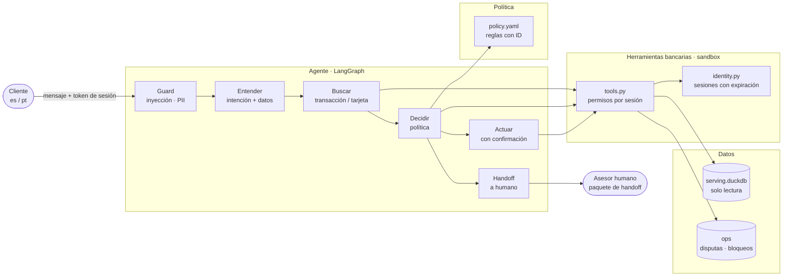
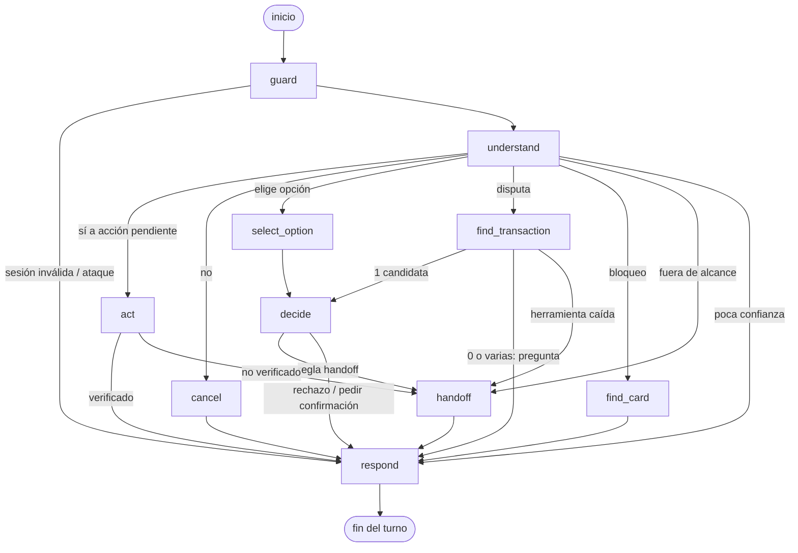
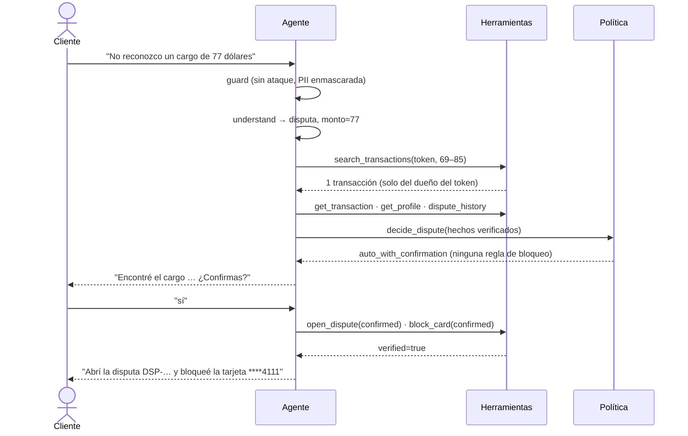
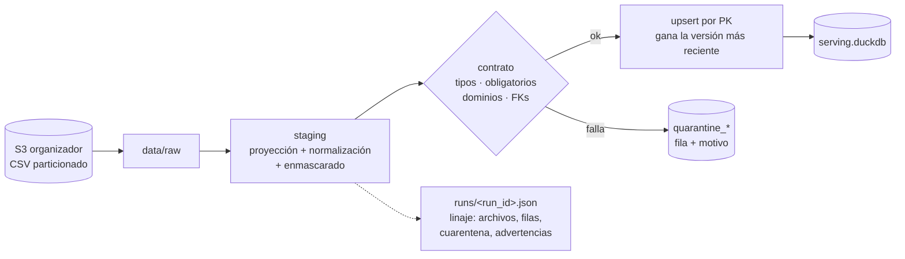
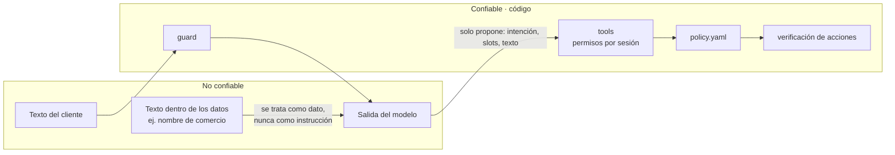

# Arquitectura

> Un agente de disputas de cargos no reconocidos. **El modelo interpreta y redacta; el código decide y actúa.**

## 1. Vista general: 4 capas

| Capa | Qué hace | Por qué así |
|---|---|---|
| Datos | Contrato por tabla, cuarentena, upsert incremental, linaje | Reproducible y auditable; los problemas se reportan, no se ocultan |
| Herramientas | Única puerta a los datos; derivan el cliente del token | Los permisos no dependen del prompt |
| Política | Reglas declarativas y versionadas | El modelo nunca decide la elegibilidad |
| Agente | Orquesta pasos explícitos | Cada transición está declarada y queda trazada |

## 2. Quién decide qué

| Decisión | Responsable | Tipo |
|---|---|---|
| ¿La sesión es válida? ¿El dato es suyo? | `identity.py` + `tools.py` | Código |
| ¿El mensaje es un ataque? | `guard.py` (`InjectionDetector`) | Patrones (default) · clasificador ONNX opt-in, evaluado en [ADR 0004](adr/0004-deteccion-inyeccion.md) |
| ¿Qué quiere el cliente? | `Router` (interfaz) | Reglas (línea base) · LLM · otro modelo |
| ¿Cuál es la transacción? | `search_transactions` + aclaración | Código; pregunta si hay más de una |
| ¿Procede la disputa o va a un humano? | `policy.yaml` | Reglas con ID |
| ¿Ejecutar la acción? | Cliente (confirmación) + `tools.py` (verificación) | Humano + código |
| ¿Cómo se dice? | `Writer` | Plantillas (línea base) · LLM + verificador *(próximo)* |

## 3. El grafo

Generado desde el código (`Agent.mermaid()`); cada nodo solo puede ir a los destinos declarados en `EDGES`.

El estado persiste entre turnos (checkpointer por conversación). Así funcionan las aclaraciones ("¿cuál de estas?") y las confirmaciones ("¿confirmas?").

## 4. Una disputa de punta a punta

## 5. Datos: raw → serving

- **Incremental por archivo:** el pipeline guarda qué archivos procesó. Un archivo nuevo, aunque sea de un día viejo (llegada tardía), se procesa y se hace upsert. Re-ejecutarlo no duplica nada.
- **Frescura:** foto fija con `as_of` = 2026-06-17. En producción serían particiones diarias con reproceso de 3 días y una alerta si `max(process_date)` tiene más de 2 días de atraso.
- **Minimización:** solo se cargan las columnas que el flujo usa y el número de tarjeta se enmascara al ingerir.
- Hallazgos de calidad: [`reports/EDA_findings.md`](../reports/EDA_findings.md).

## 6. Fronteras de confianza

**Defensa en profundidad:** aunque el guard no detecte un ataque, el ataque no tiene con qué hacer daño. El cliente sale del token y no del texto, cada acción requiere confirmación y se verifica, y la política no está en el prompt. Por eso reportamos por separado la **detección** (el guard) y el **daño** (registros señuelo): ver [`reports/injection_eval.md`](../reports/injection_eval.md).
