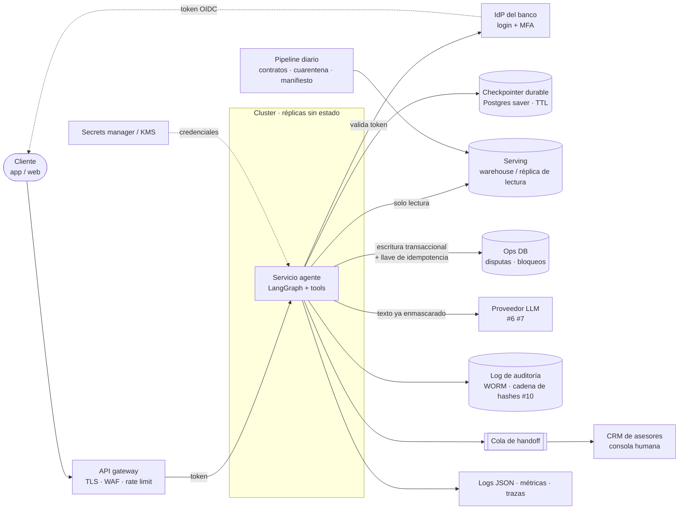

# Operación: del demo a producción

> Qué hace falta para operar el agente en un banco, qué ya está probado y qué no. Las cifras de capacidad salen de
> [`reports/capacity.md`](../reports/capacity.md) (medidas, una sola máquina, sin LLM). Lo que no está medido se
> marca como **supuesto**; lo que no existe todavía, como **por implementar**. Nada de esto es asesoría legal.

**Evidencia de auditoría = fuentes + reglas + registros de ejecución.** Cada respuesta se explica con: los
registros que leyeron las herramientas (`verified_facts`), las reglas de `config/policy.yaml` que se cumplieron
(`rules_fired`, con versión) y la traza por nodo (`trace`: nodo, ms, herramientas, intentos, errores). El
razonamiento interno de un modelo **no** es un artefacto de auditoría y no se guarda como tal.

## 1. Topología

### Hoy (hackathon)
Un proceso Python: `Agent` (LangGraph) con `InMemorySaver`, `IdentityService` simulado en memoria, `serving.duckdb`
de solo lectura y un almacén `ops` en memoria. Setup reproducible: `pip install -e ".[dev]"`, `pytest -q` sin datos
ni llaves, pipeline idempotente con manifiesto (`data/runs/<run_id>.json`). UI y contenedor: #14.

### Producción (propuesta)

| Pieza | Demo | Producción | Por qué |
|---|---|---|---|
| Estado de conversación | `InMemorySaver` | `langgraph-checkpoint-postgres` con TTL | Réplicas sin estado; sobrevive reinicios |
| Identidad | `IdentityService` simulado (TTL 15 min) | IdP del banco (OIDC) + MFA; el agente solo valida el token | El texto nunca autentica |
| Serving | DuckDB archivo, solo lectura | Warehouse / réplica de lectura con índice por `customer_id` | Varias réplicas leyendo a la vez |
| Ops (disputas, bloqueos) | DuckDB en memoria | Base transaccional (Postgres) con llave de idempotencia por acción | Hoy la idempotencia es "leer y luego insertar" (ver riesgos) |
| Acciones reales | Tablas `ops` | APIs del core (bloqueo de tarjeta, alta de disputa) con la misma verificación posterior | La verificación ya existe (`verified=True`) |
| Auditoría | `trace` en el estado; log con cadena de hashes (#10) | Almacenamiento WORM (object lock) | Inmutable por diseño, no por disciplina |
| Handoff | Paquete en la respuesta | Cola durable hacia el CRM de asesores | Nada se pierde si el CRM está caído |
| Secretos | `.env` local (gitleaks en CI) | Secrets manager + KMS, rotación | Sin llaves en imagen ni en variables de CI |

## 2. Capacidad y plan de escalado

Medido con `python scripts/loadtest.py` (detalle, máquina y caveats en [`reports/capacity.md`](../reports/capacity.md)):

| Configuración (sin LLM, laptop 4 núcleos compartida) | Turnos/s | p95 por turno | Error |
|---|---|---|---|
| `main` antes: una conexión DuckDB para todos los hilos | 4–11 | 0.6–3.6 s | **7–11% y fuga entre clientes** |
| Cursor por hilo, sin índices | ≤ 16 | 0.2–4.8 s | 0% |
| Cursor por hilo + índices, **1 réplica, 8 hilos** | **61** | **0.23 s** | 0% |
| 8 réplicas (procesos) | 98 | 0.16 s | 0% |

- **Límite de una réplica:** 8–16 hilos. Con más, el GIL y el runner de LangGraph disparan la latencia (32 hilos:
  p95 2.1 s). Se escala con procesos/réplicas, no con hilos.
- **CPU por turno:** ~25–32 ms (antes ~135 ms): ~30–40 turnos/s por núcleo.
- **Con LLM (estimación, no medición):** p50 ≈ 1.5–2.8 s, p95 ≈ 4–6 s por turno; el límite pasa a ser la cuota del
  proveedor. Números reales: #12.

**Plan de escalado:** (1) índices por `customer_id` (hecho en este PR); (2) escalar horizontalmente con réplicas sin
estado, 8–16 hilos cada una (~0.6–1 GB de memoria por réplica, casi todo caché de la base local); (3) mover serving a un motor
cliente-servidor cuando haya más de un nodo; (4) con LLM, el límite deja de ser la CPU y pasa a ser la **latencia y
cuota del proveedor**: dimensionar por conversaciones concurrentes × llamadas por turno contra el límite de tokens/min
contratado, con colas y *backpressure* en el gateway.

## 3. Monitoreo

Hoy cada nodo deja una entrada en `trace`; con `BANKAGENT_LOG_JSON=1` además se emite como una línea JSON
(`src/bankagent/observability.py`, sin texto del cliente ni token). Los SLI se calculan sobre esas líneas.

| SLI | Cómo se mide hoy | SLO / alerta | Qué hace el on-call |
|---|---|---|---|
| Latencia por turno p95 | suma de `ms` por turno (trace) · evento por turno: **por implementar** | SLO p95 < 3 s con LLM; alerta si p95 > 5 s por 10 min | Ver qué nodo creció (`node`, `ms`); si es un tool, ver DB; si es LLM, proveedor |
| Tasa de error (5xx / excepción no controlada) | capa API: **por implementar** (el grafo convierte `ToolError`/`AuthError` en salidas seguras) | < 0.5%; alerta > 1% por 5 min | Rollback del último deploy; revisar logs |
| Fallas de herramienta | `tools[].ok=false`, `error` · `tool_errors` en el JSON | alerta si > 2% de llamadas en 5 min | Salud de serving/ops; el agente ya deriva a humano (`tool_failure`) |
| Reintentos | `tools[].attempt > 1` · `retries` en el JSON | alerta si > 5% de llamadas | Anticipa una caída: revisar latencia de DB |
| Tasa de handoff | nodo `handoff`, `detail` = motivo | línea base del eval (#12) ± 10 pp; alerta si sube > 10 pp en 1 h | Desglosar por motivo: `tool_failure` = incidente; `H0x` = cambio de datos/política |
| Resolución automática segura | nodo `act` con `case=…` y ambos `verified=True` | seguimiento; alerta si `action_not_verified` > 0 | Cada `action_not_verified` se revisa a mano en core |
| Fallback LLM → reglas | `understanding.router` (#6) · contador en el JSON: **por implementar** | alerta si > 5% en 15 min | Estado del proveedor, cuota, timeouts |
| Rechazos del verificador de salida | #7: **por implementar** | alerta si > 2% | Posible regresión del prompt/modelo: congelar versión |
| Bloqueos del guard | nodo `guard`, `detail` = `injection_pattern=…` | alerta si > 3× la media de 7 días | ¿Ataque en curso o falso positivo nuevo? Ver patrón que dispara |
| Bloqueo por intentos | handoff `security_lockout` (#10) | alerta con > 20 por hora | Revisar origen; coordinar con fraude |
| Sesiones expiradas / sin sesión | `outcome=auth_error`, `detail` | alerta si sube > 3× | Suele ser el IdP o un cambio de TTL |
| Frescura de datos | manifiesto: `max_partition` por tabla | alerta si `hoy - max(process_date)` > 2 días | Ver corrida del pipeline; si hay datos viejos, el agente sigue pero se avisa en el handoff |
| Tasa de cuarentena | manifiesto: `rows_quarantined / rows_in` | alerta si > 1% o > 3× la media | Contrato roto en origen: abrir incidente con el dueño del dato |
| Huella de la entrega | manifiesto: `source_fingerprint` (#18) | alerta si cambia fuera de la ventana esperada | Datos regenerados: re-generar casos de eval y guion de demo |

**Tableros:** (1) salud del servicio: turnos/s, p50/p95/p99 por turno y por nodo, errores; (2) resultado del
negocio: resuelto / handoff por motivo / rechazo por regla / cancelado; (3) seguridad: guard, bloqueos por
intentos, `forbidden`, sesiones; (4) modelo: fallback, rechazos del verificador, latencia y costo por llamada (#12);
(5) datos: frescura, cuarentena, filas por corrida, huella.

## 4. Controles de acceso

| Componente | Puede | No puede |
|---|---|---|
| Servicio agente | Leer serving **solo a través de `tools.py`**, filtrado por el cliente del token; escribir en ops solo `block_card` / `open_dispute` con confirmación | Escribir en serving (conexión `read_only`); aceptar un `customer_id` del texto |
| Modelo (router / writer) | Proponer intención, datos y texto | Llamar herramientas, decidir política, ver datos de otro cliente |
| Pipeline | Escribir serving y cuarentena | Ser llamado por el agente |
| Asesor humano (CRM) | Ver paquetes de handoff de su cola; resolver disputas | Ver transcripciones sin caso asignado |
| Supervisor / auditor | Leer log de auditoría y tableros | Modificar el log (WORM) |
| Dueño de política | Cambiar `policy.yaml` por PR revisado (versión en cada decisión) | Cambiarla en caliente |

- **Sesión:** token opaco del IdP, TTL 15 min (`IdentityService(ttl_seconds=900)`); expira a mitad de conversación
  sin filtrar nada (`test_no_session_and_expired_session`).
- **PII:** `guard.redact` enmascara tarjeta, email, teléfono y CURP antes del router y de la conversación guardada;
  los números de tarjeta se enmascaran al ingerir (`mask_last: 4`).
- **Qué sale al proveedor LLM (#6/#7):** el mensaje del cliente ya enmascarado y, para el writer, hechos mínimos
  (fecha, monto, comercio, últimos 4 dígitos, ID de caso). No salen: token, `customer_id`, documento, historial.
  Requiere acuerdo de procesamiento de datos y retención cero en el proveedor (**supuesto**, por negociar).

## 5. Retención de datos (supuestos a validar con Legal/Compliance)

| Dato | Retención propuesta | Dónde | Borrado |
|---|---|---|---|
| Transcripción (enmascarada) | 90 días | Checkpointer / almacén de conversaciones | Job diario por TTL; al cerrar la sesión se purga el estado vivo |
| Log de auditoría (traza, reglas, acciones) | 5 años (**supuesto**: en la región los plazos para registros financieros suelen ser de 5 a 10 años) | WORM | Solo al vencer el plazo; nunca por pedido individual |
| Paquete de handoff | Lo que dure el caso en el CRM + plazo del expediente de reclamos | CRM | Según el ciclo de vida del caso |
| Manifiestos del pipeline | 2 años | `data/runs/` → almacenamiento de objetos | Por antigüedad |
| Cuarentena | 30 días (tiempo para corregir el origen) | serving | Job por `_run_id` |
| Datos del hackathon | Hasta el cierre del evento | local | Borrar `data/` al terminar |

**Minimización:** el pipeline solo carga las columnas que el flujo usa (`config/contracts.yaml`). Del cliente **no**
se cargan documento, email, dirección, fecha de nacimiento, ingreso ni score (`test_pii_columns_not_loaded`).

## 6. Frescura y actualización de datos

- Particiones diarias por `process_date`; cada corrida reprocesa los **últimos 3 días** (llegadas tardías) y hace
  upsert por clave primaria. Re-ejecutar no duplica (`test_rerun_is_idempotent_and_late_arrivals_upsert`).
- Alerta si `max(process_date)` tiene **más de 2 días** de atraso.
- Si el organizador (o el banco) regenera la entrega, cambia la huella (`source_fingerprint`, #18) y los IDs dejan de
  coincidir ([`reports/snapshot_diff.md`](../reports/snapshot_diff.md) en #18): se reconstruye serving desde cero y
  se regeneran los casos de evaluación.
- Los índices por `customer_id` se recrean al final de cada corrida (`pipeline.LOOKUP_INDEXES`).

## 7. Modos de falla y runbook

| Falla | Qué hace el sistema hoy | Evidencia | Qué hace el on-call |
|---|---|---|---|
| Proveedor LLM caído / lento | Router cae a `RuleRouter`, writer a plantillas (#6/#7) | Tests de fallback en #6/#7 | Nada urgente; confirmar que la tasa de fallback baja al volver el proveedor |
| Serving caído (error transitorio) | Hasta 2 reintentos por llamada (`max_retries=2`), luego handoff `tool_failure` con paquete | `test_agent.py` (reintentos y falla persistente) | Restaurar DB; revisar handoffs `tool_failure` del período |
| Acción no verificada | No se reporta como hecha; handoff `action_not_verified` | `act` en `graph.py` | Confirmar en core si quedó registrada |
| `policy.yaml` inválido | YAML roto o expresión no permitida → excepción al construir `PolicyEngine`: **fail closed**, no arranca. Una regla bien formada que nombra un campo inexistente solo falla al decidir (excepción no controlada = error del turno, sin acción) | `_compile` valida el AST | Rollback del cambio de política. **Por implementar:** evaluar todas las reglas contra un caso de prueba al arrancar |
| Dos confirmaciones simultáneas de la misma disputa | Lectura-luego-inserción en `open_dispute`: la segunda choca con `UNIQUE(transaction_id)` y el turno falla sin duplicar | — | En producción: llave de idempotencia + `INSERT … ON CONFLICT` |
| Store de sesiones / IdP caído | Todo turno termina en `auth_error` (no se atiende sin sesión) | `guard` resuelve el token primero | Escalar al equipo del IdP; banner en la app |
| Checkpointer caído | Hoy en memoria: un reinicio pierde las conversaciones abiertas (**por implementar**: Postgres saver) | — | El cliente debe repetir; nada queda a medias porque la acción exige confirmación en el mismo estado |
| Pico de bloqueos del guard | Responde `blocked_input`; bloqueo por intentos lleva a humano (#10) | `test_security.py` | Ver si es campaña o falso positivo; ajustar patrón por PR |
| Datos viejos | El agente sigue respondiendo con lo que hay | Manifiesto | Relanzar pipeline; si > 2 días, avisar a los asesores |
| Muchos hilos sobre una conexión DuckDB | **Corregido en este PR**: un cursor por hilo (antes un cliente podía recibir filas de otro) | `tests/test_concurrency.py` | — |

## 8. Trabajo restante antes de producción (priorizado, honesto)

**Bloqueantes**
1. Política real escrita y aprobada por Legal/Riesgo del banco (hoy `policy.yaml` es sintética) y revisión de
   cumplimiento del flujo (plazos regulatorios de disputa por país, avisos al cliente).
2. Integración con el IdP real (OIDC + MFA) y con las APIs del core para bloqueo y disputa, con llaves de
   idempotencia y reconciliación.
3. Checkpointer durable (Postgres), ops transaccional y log de auditoría en WORM.
4. Pentest y red team del agente con LLM (inyección directa e indirecta, exfiltración, abuso de herramientas); hoy
   hay tests y eval de inyección (#8/#9), no un ejercicio adversarial externo.
5. Evaluación humana de las salidas del LLM (tono, exactitud, dialecto) sobre una muestra estratificada; revisión
   nativa del portugués.
6. Prueba de carga **con LLM real** (latencia, errores 429, costo por conversación) y límites de cuota acordados.

**Necesarios**
7. Métricas y alertas de la sección 3 implementadas (evento por turno, contadores, tableros) y guardias on-call.
8. Retención y borrado automáticos (sección 5) validados por Compliance; DPA con el proveedor LLM.
9. Multi-región / DR: RPO/RTO definidos, backups de ops y checkpointer probados, runbook de conmutación.
10. Accesibilidad de la UI (WCAG 2.1 AA) y canal alternativo para quien no puede usar el chat.
11. Dependencias fijadas con hashes y acciones de CI por SHA (#17); escaneo de imagen.
12. Monitoreo de deriva: distribución de intenciones, tasa de handoff por segmento y equidad por dialecto (#13).
