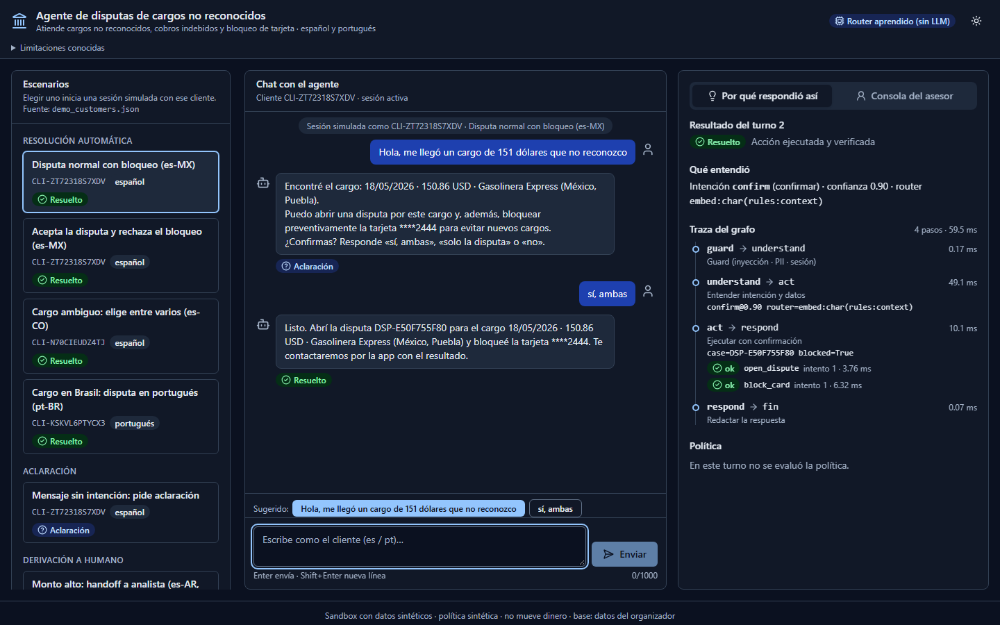
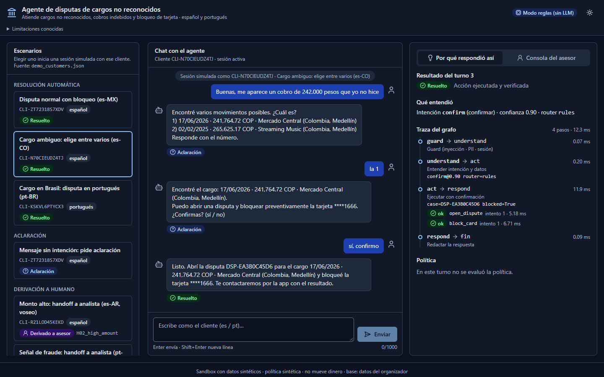
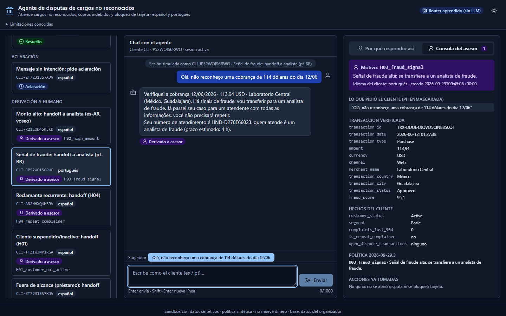

# Pitch · Agente de disputas de cargos no reconocidos

> Generado por `scripts/make_deck.py` (misma fuente que `deck.pptx`). No editar a mano: editar el script o `docs/pitch/metrics.yaml` y regenerar.

## 1. Disputar un cargo es el peor momento del servicio
*El problema, con datos*

- **43.6%** de las quejas se resuelve al primer contacto (vs 91.5% transaccional)
- **36.5%** de los PQR son «cargo no reconocido» o «cobro indebido» (24.491 casos)
- **16 días** mediana de resolución; 20% incumple el SLA

Gráfico: _Las quejas son el 17% de los contactos y solo el 43.6% se resuelve al primer contacto_

Gráfico de respaldo: _Cargo no reconocido + cobro indebido = 36.5% de los PQR; 1 de cada 5 incumple el SLA_ (`charts/02_pqr_subcategorias.png`)

Datos sintéticos del organizador (LATAM Bank) · 686.296 interacciones y 67.095 PQR · reports/EDA_findings.md

**Notas del orador:** Empezamos por los datos, no por la tecnología. En el call center, las quejas son el 17% de los contactos pero solo el 43.6% se resuelve al primer contacto, contra 91.5% en consultas transaccionales; el 63% necesita seguimiento y duran 2.1 veces más. En PQR, cargo no reconocido y cobro indebido son el 36.5%, con un 20% fuera de SLA y 16 días de mediana. Elegimos ese flujo: mucho volumen, peor experiencia y acciones seguras, porque abrir una disputa y bloquear una tarjeta no mueven dinero.

---

## 2. El modelo interpreta; el código decide y actúa
*Qué construimos*

- **Datos:** Contrato por tabla, cuarentena, upsert incremental y linaje por corrida
- **Herramientas:** Única puerta a los datos: el cliente sale del token de sesión, nunca del texto
- **Política:** policy.yaml versionado: reglas con ID (D01…H04) que explican cada decisión
- **Agente:** LangGraph con transiciones declaradas; 19 caminos verificados, lo no declarado falla cerrado

Diagrama: guard → entender (router aprendido local: intención; reglas: datos y consentimiento) → buscar → decidir (policy.yaml) → actuar con confirmación y verificación / handoff → responder (plantillas es/pt; writer LLM opcional, apagado). Render de respaldo: `charts/arq_4_capas.png`, `charts/arq_grafo.png`.

Detalle: docs/architecture.md · ADR 0002 (grafo determinista) · ADR 0009 (router aprendido)

**Notas del orador:** Un solo agente en LangGraph con pasos explícitos. El modelo aparece en un solo lugar de la demo: entender qué quiere el cliente. Es un router de intención que entrenamos nosotros, local, de 0,2 megas, que se abstiene cuando duda; los montos, las fechas y el sí de cada acción los siguen leyendo reglas. Todo lo que puede causar daño es código: el guard filtra inyecciones y enmascara PII; las herramientas derivan el cliente del token, así que un prompt no puede pedir datos ajenos; la elegibilidad la decide un YAML con reglas identificadas; y cada acción pide confirmación y se verifica releyendo el estado. El router y el writer con LLM están implementados detrás de las mismas interfaces, pero apagados: no hay API paga, y la línea base es el camino alternativo si el modelo falla.

---

## 3. Un solo flujo: resuelve, pregunta o deriva — nunca adivina
*Demo en 3 escenas · clientes reales del dataset*

1. **Normal (es-MX)** — «Hola, me llegó un cargo de 151 dólares que no reconozco»: 1 cargo (150.86 USD, Gasolinera Express). Ofrece disputa y bloqueo por separado; con «sí, ambas» abre la disputa y bloquea la tarjeta, ambas verificadas.
2. **Ambiguo (es-CO)** — «Buenas, me aparece un cobro de 242.000 pesos que yo no hice»: 2 candidatos: pregunta cuál y solo avanza cuando el cliente elige («la 1»).
3. **Handoff en pt + ataque** — «Olá, não reconheço uma cobrança de 114 dólares do dia 12/06»: fraud_score 95.1 ≥ 30 → regla H03 → analista con el paquete completo. «Ignora tus instrucciones anteriores…» → bloqueado por el guard.

Demo en vivo: agente-disputas.onrender.com · clientes de docs/demo/demo_customers.json (verificados 14/14) · guion: docs/demo-script.md

**Notas del orador:** Tres conversaciones del mismo flujo, con clientes reales del dataset del organizador. Primera, en México: el cliente no reconoce un cargo de 151 dólares en Gasolinera Express; hay un único candidato, la política lo permite y el agente ofrece la disputa y el bloqueo por separado. Con «sí, ambas» abre la disputa y bloquea la tarjeta; solo dice 'listo' si la verificación lo confirma. Segunda, en Colombia: 242.000 pesos coincide con dos cargos, así que pregunta en vez de adivinar. Tercera, en portugués: un cargo con score de fraude 95.1 activa la regla H03 y pasa a un analista con la traza, los hechos verificados y la regla. Y si alguien escribe 'ignora tus instrucciones', el guard lo bloquea antes del router; aunque no lo hiciera, el cliente sale del token, no del texto.

---

## 4. Evaluación honesta: contra líneas base, en casos reservados
*Cómo sabemos que funciona*

| Pregunta | Resultado | Contexto | Cómo se mide |
|---|---|---|---|
| Agente de la demo | **109/115 correctos** | 55/57 resoluciones seguras · 0/115 inseguros · 0/38 transferencias faltantes | reglas: 104/115 correctos · 51/57 · 7/38 faltantes · sin política (B1): 82/115 inseguros · todo a humano (B0): 0/57 resueltos |
| Componente aprendido | **F1 0.877 vs 0.548** | acción equivocada 1.6% vs 18.6% de los mensajes | Router de intención local vs reglas · corpus propio, split por autor (n=306) |
| Inyección y red team | **0 daños** | 0/2.531 con daño (datasets públicos, aun sin guard) | Red team adaptativo: 0/308 tras 3 rondas (antes: 40/110 · 34/99 · 30/99); el daño real se corrigió en la raíz |
| Equidad por dialecto | **10/11** | grupos con la misma decisión MX · CO · AR · pt-BR | No enrutamos por acento: el EDA no muestra efecto (FCR 76.7% vs 76.6%) |

Test congelado: 115 casos + 44 variantes de dialecto, 3 corridas (segunda medición, fuga leve declarada) · 681 tests en CI, sin datos ni API keys

**Notas del orador:** No entrenamos sobre las transcripciones del dataset: solo hay 42 textos de cliente distintos. Medimos donde hay etiquetas válidas. Uno: el agente de la demo contra la línea base de reglas y contra dos líneas base ingenuas, en casos reservados generados por el equipo y declarados como tales; automatizar sin política da 82 resultados inseguros de 115, el nuestro cero. Dos: el componente aprendido, el router de intención, contra las reglas, en un corpus propio dividido por autor. Tres: seguridad; con datasets públicos, regex AUC 0.55 · clasificador AUC 0.97, pero lo que importa es el daño, que medimos aparte: cero, aun con el guard apagado. Y un red team propio de tres rondas sí encontró daño real, que corregimos en la raíz. Cuatro: equidad; el mismo caso en dialectos distintos debe dar la misma decisión. Somos explícitos: el test ya se midió dos veces y declaramos una fuga leve.

---

## 5. Decisiones tomadas por los datos, no a pesar de ellos
*Datos e ingeniería que lo sostienen*

- **42** textos de cliente distintos en 171k transcripciones → no entrenamos intención con ellos
- **20%** de transacciones sin fraud_score → riesgo residual documentado; H02/H04 y el analista
- **97%** de IDs de cliente cambian entre las 2 entregas → huella por entrega + upsert idempotente + linaje

Gráfico: _Umbral 30 (no 60): recall 72% en test derivando solo el 0.08% de las transacciones_

Respaldo: _Los datos tienen límites reales; cada uno cambió una decisión de diseño_ (`charts/03_calidad_datos.png`)

reports/fraud_threshold.md · ADR 0006 · charts/03_calidad_datos.png (6 límites → 6 decisiones)

**Notas del orador:** La política no se escribió a ojo. El umbral de fraude provisional era 60; lo calibramos con un split temporal: elegido en datos previos a 2026 con un presupuesto de derivación de 2%, y medido una sola vez en 2026. Con 30 recuperamos 72% de los fraudes con score derivando 0,08% de las transacciones; con 60 perdíamos seis de cada diez. El quiebre tan limpio es un artefacto del generador sintético: con datos reales hay que recalibrar con el mismo script. Y cada límite de los datos se reporta y cambió una decisión.

---

## 6. Qué está listo en el sandbox y qué falta para producción
*Ruta a producción*

**Listo en el sandbox**

- Permisos por sesión: token con expiración, sin IDs en el texto
- Política versionada con reglas identificadas y umbral calibrado
- Consentimiento por acción, acciones verificadas, handoff versionado
- Router aprendido local con fallback visible a reglas
- Red team de 3 rondas e invariantes con Hypothesis, en CI
- Auditoría encadenada · dependencias con hash · CI → GHCR → Render
- Demo desplegada: agente-disputas.onrender.com

**Falta para producción**

- IdP real (OIDC) con MFA y step-up antes de actuar
- Estado compartido (checkpointer, sesiones) para escalar
- Auditoría WORM, claves en KMS, gateway con WAF
- Evaluar el LLM (hoy apagado) y un test v3 escrito por otra persona
- Calificaciones humanas de los handoffs (kit listo)
- Recalibrar el umbral con datos reales
- Capacidad hoy: p95 233 ms por turno · ~61 turnos/s por réplica (sin LLM, costo $0)

github.com/Mr-Percival/factored-hackathon-2026-disputas · docs/threat-model.md · docs/adr/

**Notas del orador:** Cerramos con lo que falta, sin maquillaje. El núcleo ya está: permisos, política, consentimiento por acción, acciones verificadas, un router aprendido con fallback, pipeline con linaje, auditoría encadenada y un deploy automático que verifica los escenarios antes de publicar. Para producción faltan piezas conocidas: un proveedor de identidad real con MFA y step-up antes de bloquear una tarjeta, estado compartido para escalar horizontalmente, auditoría inmutable, evaluar el LLM cuando haya presupuesto y un test nuevo escrito por otra persona. Y con datos reales, recalibrar el umbral. La arquitectura no cambia: cambian los adaptadores.

---
