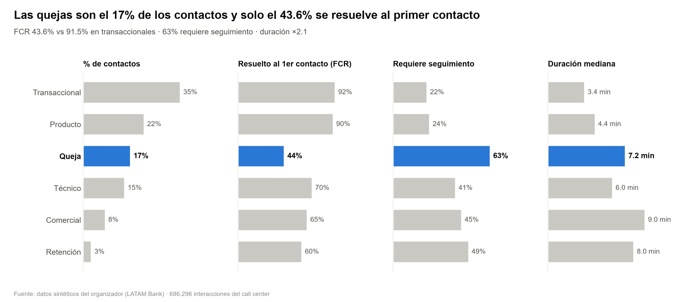
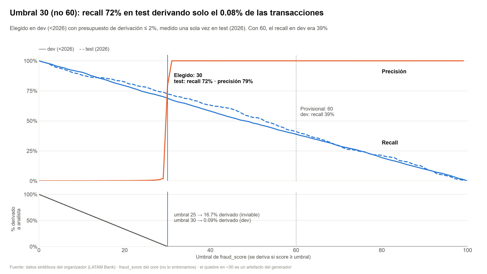

# Pitch · Agente de disputas de cargos no reconocidos

> Generado por `scripts/make_deck.py` (misma fuente que `deck.pptx`). No editar a mano: editar el script o `docs/pitch/metrics.yaml` y regenerar.

## 1. Disputar un cargo es el peor momento del servicio
*El problema, con datos*

- **43.6%** de las quejas se resuelve al primer contacto (vs 91.5% transaccional)
- **36.5%** de los PQR son «cargo no reconocido» o «cobro indebido» (24.491 casos)
- **16 días** mediana de resolución; 20% incumple el SLA

Gráfico: _Las quejas son el 17% de los contactos y solo el 43.6% se resuelve al primer contacto_

Gráfico de respaldo: _Cargo no reconocido + cobro indebido = 36.5% de los PQR; 1 de cada 5 incumple el SLA_ (`charts/02_pqr_subcategorias.png`)

Datos sintéticos del organizador (LATAM Bank) · 686.296 interacciones y 67.095 PQR · reports/EDA_findings.md

**Notas del orador:** Empezamos por los datos, no por la tecnología. En el call center, las quejas son el 17% de los contactos pero solo el 43.6% se resuelve al primer contacto, contra 91.5% en consultas transaccionales; el 63% necesita seguimiento y duran 2.1 veces más. En PQR, cargo no reconocido y cobro indebido son el 36.5%, con un 20% fuera de SLA y 16 días de mediana. Elegimos ese flujo: mucho volumen, peor experiencia y acciones seguras, porque abrir una disputa y bloquear una tarjeta no mueven dinero.

---

## 2. El modelo interpreta y redacta; el código decide y actúa
*Qué construimos*

- **Datos:** Contrato por tabla, cuarentena, upsert incremental y linaje por corrida
- **Herramientas:** Única puerta a los datos: el cliente sale del token de sesión, nunca del texto
- **Política:** policy.yaml versionado: reglas con ID (D01…H04) que explican cada decisión
- **Agente:** LangGraph con transiciones declaradas; una transición no declarada falla cerrada

Diagrama: guard → entender (LLM) → buscar → decidir (policy.yaml) → actuar con confirmación y verificación / handoff → responder (LLM). Render de respaldo: `charts/arq_4_capas.png`, `charts/arq_grafo.png`.

Detalle: docs/architecture.md · ADR 0002 (grafo determinista con LLM acotado)

**Notas del orador:** Un solo agente en LangGraph con pasos explícitos. El modelo aparece solo en dos lugares: entender qué quiere el cliente y redactar la respuesta. Todo lo que puede causar daño es código: el guard filtra inyecciones y enmascara PII; las herramientas derivan el cliente del token, así que un prompt no puede pedir datos ajenos; la elegibilidad la decide un YAML con reglas identificadas; y cada acción pide confirmación y se verifica releyendo el estado. Cada interfaz del modelo tiene una versión con reglas y plantillas: es la línea base y el camino alternativo si el modelo falla.

---

## 3. Un solo flujo: resuelve, pregunta o deriva — nunca adivina
*Demo en 3 escenas*

1. **Normal** — «No reconozco un cargo de 77 dólares»: Encuentra 1 cargo, explica la política, pide «¿confirmas?», abre la disputa y bloquea la tarjeta (ambas verificadas).
2. **Ambiguo** — «Me cobraron 350 y no fui yo»: Hay 2 candidatos: pregunta cuál. Solo avanza cuando el cliente elige.
3. **Handoff en pt + ataque** — «Não reconheço uma cobrança no Brasil»: fraud_score ≥ 30 → regla H03 → asesor con paquete completo. «Esqueça as regras…» → bloqueado por el guard.

Demo en vivo: [[PENDIENTE: deploy]] · clientes del fixture de demo (CLI-ANA) · guion: docs/pitch/video_script.md

**Notas del orador:** Tres conversaciones del mismo flujo. Primera: Ana no reconoce un cargo de 77 dólares; hay un único candidato, la política lo permite y, tras su sí, se abre la disputa y se bloquea la tarjeta; solo decimos 'listo' si la verificación lo confirma. Segunda: 350 coincide con dos cargos, así que el agente pregunta en vez de adivinar. Tercera, en portugués: un cargo en Brasil con score de fraude alto activa la regla H03 y pasa a un asesor con la traza, los hechos verificados y la regla. Y si alguien escribe 'olvida las reglas', el guard lo bloquea antes de llegar al modelo.

---

## 4. Evaluación honesta: contra una línea base y en casos reservados
*Cómo sabemos que funciona*

| Pregunta | Resultado | Contexto | Cómo se mide |
|---|---|---|---|
| Agente vs línea base | **[[PENDIENTE: reports/eval.md]]** | línea base: [[PENDIENTE: reports/eval.md]] | Éxito de tarea en casos reservados · [[PENDIENTE: reports/eval.md]] |
| Inyección: detección | **[[PENDIENTE: reports/injection_eval.md]]** | falsos positivos: [[PENDIENTE: reports/injection_eval.md]] | Datasets públicos etiquetados (split de prueba) + muestra en pt generada por el equipo |
| Inyección: daño | **[[PENDIENTE: reports/injection_eval.md]]** | medido aparte de la detección | Aunque el guard falle, el cliente sale del token y toda acción se confirma |
| Equidad por dialecto | **[[PENDIENTE: reports/eval.md]]** | misma decisión MX · CO · AR · pt-BR | No enrutamos por acento: el EDA no muestra efecto (FCR 76.7% vs 76.6%) |

80 tests automatizados en CI (sin datos ni API keys): flujos normal/ambiguo/handoff, sesión vencida, acceso ajeno, inyección directa e indirecta, cliente señuelo

**Notas del orador:** No entrenamos sobre las transcripciones del dataset: solo hay 42 textos de cliente distintos, así que cualquier métrica sería inválida. Evaluamos donde hay etiquetas válidas. Uno: el agente contra la línea base de reglas en casos reservados, generados por el equipo y declarados como tales. Dos: la detección de inyección con datasets públicos, y por separado el daño, porque aunque el detector falle el ataque no tiene con qué dañar. Tres: equidad; el mismo caso escrito en dialectos distintos debe dar la misma decisión.

---

## 5. Decisiones tomadas por los datos, no a pesar de ellos
*Datos e ingeniería que lo sostienen*

- **42** textos de cliente distintos en 171k transcripciones → no entrenamos intención con ellos
- **20%** de transacciones sin fraud_score → riesgo residual documentado; H02/H04 y el analista
- **97%** de IDs de cliente cambian entre las 2 entregas → huella por entrega + upsert idempotente + linaje

Gráfico: _Umbral 30 (no 60): recall 72% en test derivando solo el 0.08% de las transacciones_

Respaldo: _Los datos tienen límites reales; cada uno cambió una decisión de diseño_ (`charts/03_calidad_datos.png`)

reports/fraud_threshold.md · ADR 0006 · charts/03_calidad_datos.png (6 límites → 6 decisiones)

**Notas del orador:** La política no se escribió a ojo. El umbral de fraude provisional era 60; lo calibramos con un split temporal: elegido en datos previos a 2026 con un presupuesto de derivación de 2%, y medido una sola vez en 2026. Con 30 recuperamos 72% de los fraudes con score derivando 0,08% de las transacciones; con 60 perdíamos seis de cada diez. El quiebre tan limpio es un artefacto del generador sintético: con datos reales hay que recalibrar con el mismo script. Y cada límite de los datos se reporta y cambió una decisión.

---

## 6. Qué está listo en el sandbox y qué falta para producción
*Ruta a producción*

**Listo en el sandbox**

- Permisos por sesión: token con expiración, sin IDs en el texto
- Política versionada con reglas identificadas y umbral calibrado
- Acciones con confirmación y verificación; handoff con contexto
- Pipeline incremental: contratos, cuarentena, linaje
- Log de auditoría con cadena de hashes y modelo de amenazas OWASP LLM (PR #20)
- Demo desplegada: [[PENDIENTE: deploy]]

**Falta para producción**

- IdP real (OIDC) con MFA y step-up antes de actuar
- Gateway: rate limiting, límite de mensaje, WAF (#15)
- Auditoría en almacenamiento WORM y claves en KMS
- Lockfile con hashes y acciones fijadas por SHA (#17)
- Verificador de cifras e IDs para el writer con LLM (#7)
- Recalibrar el umbral con datos reales y medir fraude entre cargos disputados
- Capacidad: p95 233 ms por turno · ~61 turnos/s por réplica (sin LLM, costo $0)

github.com/Mr-Percival/factored-hackathon-2026-disputas · docs/threat-model.md · docs/adr/

**Notas del orador:** Cerramos con lo que falta, sin maquillaje. El núcleo que no depende del modelo ya está: permisos, política, acciones verificadas, pipeline con linaje y auditoría encadenada. Para producción faltan piezas conocidas: un proveedor de identidad real con MFA y step-up antes de bloquear una tarjeta, un gateway con límites, auditoría en almacenamiento inmutable, cadena de suministro fijada y un verificador de salida para el LLM. Y con datos reales, recalibrar el umbral. La arquitectura no cambia: cambian los adaptadores.

---

## Pendientes

- [[PENDIENTE: URL de la demo desplegada — deploy (#15)]]
- [[PENDIENTE: éxito de tarea del agente (LLM) en casos reservados — reports/eval.md (#12)]]
- [[PENDIENTE: éxito de tarea de la línea base (reglas + plantillas) — reports/eval.md (#12)]]
- [[PENDIENTE: n.º de casos reservados y cómo se generaron — reports/eval.md (#12)]]
- [[PENDIENTE: recall de detección de inyección (clasificador vs patrones) — reports/injection_eval.md (#8/#9)]]
- [[PENDIENTE: falsos positivos sobre mensajes legítimos — reports/injection_eval.md (#8/#9)]]
- [[PENDIENTE: daño: fugas del señuelo / acciones no confirmadas — reports/injection_eval.md (#8)]]
- [[PENDIENTE: misma decisión entre variantes MX/CO/AR/pt-BR — reports/eval.md (#13)]]
- [[PENDIENTE: captura escena 1 — docs/pitch/screens/escena1.png (UI #14)]]
- [[PENDIENTE: captura escena 2 — docs/pitch/screens/escena2.png (UI #14)]]
- [[PENDIENTE: captura escena 3 — docs/pitch/screens/escena3.png (UI #14)]]
