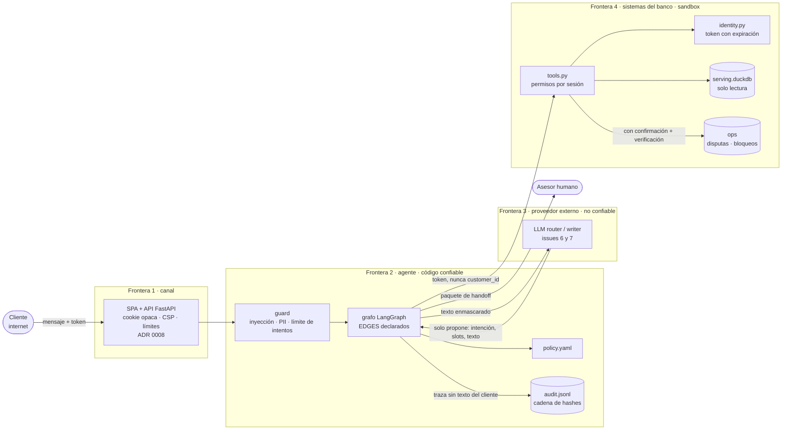

# Modelo de amenazas

> Alcance: el agente de disputas de cargos no reconocidos (sandbox del hackathon). Mapeado a
> [OWASP Top 10 para aplicaciones LLM, edición 2025](https://genai.owasp.org/llm-top-10/) más amenazas clásicas
> que no son de LLM. Cada control apunta al código que lo implementa y al test que lo prueba; si todavía no
> existe, al issue abierto. El riesgo residual se dice sin maquillaje.

**Supuesto central:** todo texto que venga del cliente, de los datos (ej. nombre de comercio) o de un modelo es
**no confiable**. Por eso los permisos, la política y la verificación viven en código, no en el prompt
([ADR 0002](adr/0002-grafo-deterministico-con-llm-acotado.md)). Medimos por separado la **detección** de un
ataque (guard) y el **daño** posible (registros señuelo): aunque el guard falle, el ataque no tiene con qué dañar.

## Flujo de datos y fronteras de confianza

## Amenazas LLM (OWASP 2025)

| Amenaza | OWASP LLM | Control en el sistema | Test que lo prueba | Riesgo residual |
|---|---|---|---|---|
| Inyección directa ("ignora tus instrucciones…", "ahora eres admin") | LLM01 | `guard.detect_injection` corre antes de cualquier modelo; `Agent.guard` responde `blocked_input`. Tras 3 intentos la conversación se bloquea y pasa a humano (`security_lockout`) | `tests/test_security.py::test_direct_injection_is_blocked_and_leaks_nothing`, `tests/test_audit.py::test_lockout_after_repeated_injection` | Los patrones regex tienen falsos negativos (parafraseo, otros idiomas, ofuscación). Medición con datasets públicos en #8 y clasificador aprendido en #9. Aunque pase, el daño está acotado por los controles de LLM06 |
| Inyección indirecta (instrucciones dentro de los datos, ej. nombre de comercio) | LLM01 | Los datos se tratan como dato: el router recibe solo el texto del cliente; las plantillas insertan el comercio como valor; toda acción exige confirmación | `tests/test_security.py::test_indirect_injection_in_data_has_no_effect` | Cuando el writer con LLM (#7) reciba datos de comercio en su prompt, el verificador de salida de #7 debe impedir que el texto cambie cifras/acciones. Eval en #8 |
| Divulgación de información sensible (datos de otro cliente, PII en logs o al proveedor) | LLM02 | Cliente derivado del token (`tools.BankTools`, filtro por `customer_id`); `guard.redact` antes del router y de la conversación; el pipeline no carga columnas PII y enmascara la tarjeta; el log de auditoría no guarda texto del cliente y seudonimiza el thread (HMAC) | `tests/test_security.py::test_canary_never_leaks_across_all_conversations`, `::test_pii_is_redacted_before_leaving_the_guard`, `tests/test_pipeline.py::test_pii_columns_not_loaded`, `::test_normalization_and_masking`, `tests/test_audit.py::test_every_trace_entry_is_persisted_without_customer_text` | `redact` es por regex (formatos no previstos pasan). El paquete de handoff contiene texto enmascarado del cliente, por diseño (el asesor lo necesita). Sin DPA/retención definida con el proveedor LLM (#6) |
| Cadena de suministro (dependencias, acciones de CI, procedencia del modelo) | LLM03 | Dependencias mínimas (3 en runtime); secretos fuera del repo; el modelo LLM se consume por API de un proveedor identificado (#6) | — (sin test) → #17 | **Abierto:** `pyproject.toml` solo tiene cotas inferiores, sin lockfile con hashes; acciones de CI por tag, no por SHA; revisión del modelo de #9 sin fijar. Todo en #17 |
| Envenenamiento de datos o modelo | LLM04 | No entrenamos con datos del banco ([ADR 0003](adr/0003-sin-modelo-entrenado-en-datos-del-banco.md)); contrato de datos con cuarentena y linaje por corrida (`pipeline.py`); la política es un YAML versionado y revisado en PR, no aprendido | `tests/test_pipeline.py::test_contract_quarantines_invalid_rows`, `::test_rerun_is_idempotent_and_late_arrivals_upsert` | El dataset es sintético y su procedencia es el organizador; no hay firma de los archivos de S3. El umbral de `fraud_score` (#4) depende de datos que podrían estar sesgados |
| Manejo inadecuado de la salida (salida del modelo usada como comando/SQL/HTML) | LLM05 | El router solo devuelve `Understanding` tipado; el grafo decide la transición y rechaza las no declaradas (`Agent._traced` + `EDGES`); las herramientas usan SQL parametrizado; la respuesta hoy sale de plantillas (`TemplateWriter`) | `tests/test_security.py::test_undeclared_transition_fails_closed`, `::test_indirect_injection_in_data_has_no_effect` | El verificador de salida del writer con LLM (cifras, fechas, IDs) está pendiente en #7. La UI pinta la respuesta como texto plano (React escapa; sin HTML/Markdown activo) y la CSP prohíbe scripts inline (`tests/test_api.py::test_security_headers_everywhere`) |
| Agencia excesiva (el modelo actúa solo o con más permisos de los necesarios) | LLM06 | El modelo no llama herramientas; solo 2 acciones (`open_dispute`, `block_card`), ambas con `confirmed=True` explícito del cliente y verificadas releyendo el estado; serving abierto en solo lectura; `open_dispute` revalida la propiedad | `tests/test_agent.py::test_normal_path_dispute_and_block_with_confirmation`, `::test_ambiguous_asks_which_then_resolves`, `tests/test_security.py::test_tools_refuse_other_customers_data` | La confirmación es un "sí" en el mismo canal: si el canal está comprometido (sesión robada), el atacante también confirma. En producción: step-up/MFA para acciones (ver sesiones) |
| Fuga del system prompt | LLM07 | La política, los permisos y los secretos no están en ningún prompt: si el prompt se filtra no revela nada explotable; el guard bloquea pedidos explícitos del prompt | `tests/test_security.py::test_direct_injection_is_blocked_and_leaks_nothing` (caso "reveal your system prompt") | Aplica cuando existan los prompts de #6/#7: regla de revisión de que no contengan credenciales ni reglas de negocio |
| Debilidades de vectores/embeddings | LLM08 | **No aplica:** no hay RAG ni base vectorial. Los hechos salen de consultas SQL filtradas por sesión | — | Si se agrega RAG (ej. FAQ), los documentos deben ser públicos o filtrarse por permisos antes del modelo |
| Desinformación (el agente afirma algo falso: monto, caso, regla) | LLM09 | Solo se reportan acciones con `verified=True`; los hechos vienen de lecturas verificadas (`get_transaction`); las explicaciones salen de `policy.yaml` por id de regla; las plantillas no pueden inventar cifras | `tests/test_agent.py::test_normal_path_dispute_and_block_with_confirmation` (el `case_id` de la respuesta es el verificado), `::test_policy_rejects_declined_and_old` | Con el writer LLM (#7) aparece el riesgo real; se mitiga con el verificador de #7 y se mide en #12. Equidad por dialecto en #13 |
| Consumo sin límite (costo, denegación de servicio) | LLM10 | Reintentos acotados solo para errores transitorios (`max_retries=2`); búsquedas con `limit`; bloqueo tras 3 intentos por conversación; sesión con TTL de 15 min | `tests/test_agent.py::test_persistent_tool_failure_hands_off`, `tests/test_audit.py::test_lockout_after_repeated_injection`, `::test_forbidden_access_counts_towards_lockout` | En la API web: mensaje ≤ 1.000 caracteres, cuerpo ≤ 16 KB, 30 mensajes/min por sesión y 30 logins/min por IP (`tests/test_api.py::test_rate_limit_returns_429`, `::test_body_size_limit`). El límite es en memoria y por réplica; WAF y límites globales quedan para el gateway. Timeouts y `max_tokens` del LLM en #6. El bloqueo es por conversación: abrir otra la reinicia |

## Amenazas no LLM

| Amenaza | Categoría | Control en el sistema | Test que lo prueba | Riesgo residual |
|---|---|---|---|---|
| Sesión robada o vencida | Autenticación | Token opaco y aleatorio (`secrets.token_urlsafe`) emitido por el IdP simulado, con expiración (`identity.IdentityService.resolve`); un documento o id escrito en el chat nunca autentica | `tests/test_security.py::test_no_session_and_expired_session` | El IdP es simulado: sin MFA, sin atar el token al dispositivo, sin revocación. En producción: IdP real (OIDC) + MFA + step-up para acciones |
| Robo de la sesión web (XSS) o CSRF desde otro sitio | Sesión / canal | El token del agente nunca sale del servidor: el navegador solo tiene un id opaco en cookie `HttpOnly`, `SameSite=Strict`, `Secure` bajo https, `Path=/api`; CSP `script-src 'self'` sin inline; verificación de `Origin`; CORS cerrado; conversación ligada a su sesión (una ajena da 404); errores genéricos sin eco del texto ([ADR 0008](adr/0008-frontend-web.md)) | `tests/test_api.py::test_cookie_is_httponly_strict_and_token_never_leaves_the_server`, `::test_cross_origin_writes_are_rejected`, `::test_foreign_conversation_is_not_found`, `::test_parallel_customers_only_see_their_own_data` | Estado en memoria y un worker: un reinicio borra sesiones. Sin MFA ni atadura al dispositivo (IdP simulado). `/api/docs` relaja la CSP para Swagger UI (se apaga con `BANKAGENT_DOCS=0`) |
| Control de acceso roto / IDOR sobre ids de transacción o tarjeta | Autorización | Cada herramienta deriva el cliente del token y filtra por él; un recurso ajeno da `AuthError('forbidden')`; los accesos prohibidos cuentan para el bloqueo de la conversación | `tests/test_security.py::test_tools_refuse_other_customers_data`, `::test_canary_never_leaks_across_all_conversations`, `tests/test_audit.py::test_forbidden_access_counts_towards_lockout` | `get_transaction` distingue "no existe" de "no es tuyo": un oráculo de enumeración de ids, mitigado por el bloqueo tras 3 intentos. En producción conviene responder igual en ambos casos |
| Secretos en el repositorio | Configuración | `.env` y `*.pdf` en `.gitignore`; job `secrets` con gitleaks en `.github/workflows/ci.yml` sobre todo el historial; reglas en `CONTRIBUTING.md` | CI: job `secrets` (gitleaks) | gitleaks detecta patrones conocidos, no todos. Rotar cualquier credencial que haya circulado fuera del repo |
| Manipulación del log de auditoría (editar, borrar, reordenar) | Integridad / no repudio | `audit.AuditLog`: JSONL append-only con cadena `sha256(prev_hash + json canónico)` desde un génesis fijo; `verify()` y `python -m bankagent.audit verify <ruta>` | `tests/test_audit.py::test_tampering_is_detected`, `::test_chain_continues_across_restarts`, `::test_cli_verify` | La cadena **no** detecta el truncado del final ni una reescritura completa si no se ancla el último hash fuera del sistema (`--head`). En producción: almacenamiento WORM (ej. S3 Object Lock), anclaje periódico del hash y clave del seudónimo en KMS |

## Qué falta para producción (resumen honesto)

1. **Identidad real:** IdP (OIDC) con MFA y step-up antes de abrir disputas o bloquear tarjetas.
2. **Gateway:** WAF, TLS y rate limiting global (la API ya limita por sesión/IP, tamaño y largo del mensaje, en memoria y por réplica; ADR 0008).
3. **Secretos y claves:** gestor de secretos/KMS para la clave de API del LLM y la clave del seudónimo del log.
4. **Auditoría:** almacenamiento WORM, anclaje externo del último hash, retención definida y acceso restringido.
5. **Cadena de suministro:** lockfile con hashes, acciones por SHA y modelos con revisión fijada (#17).
6. **Detección:** evaluación con datasets públicos (#8) y clasificador aprendido (#9); el regex es solo la primera línea.
7. **Salida del LLM:** verificador de cifras/fechas/IDs (#7) y evaluación en casos reservados (#12, #13).
8. **Bloqueo por cliente**, no solo por conversación, con desbloqueo auditado por un humano.
