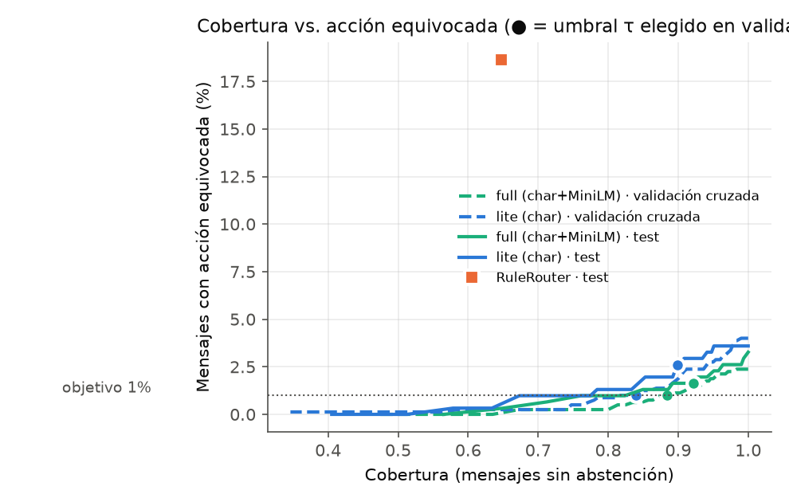
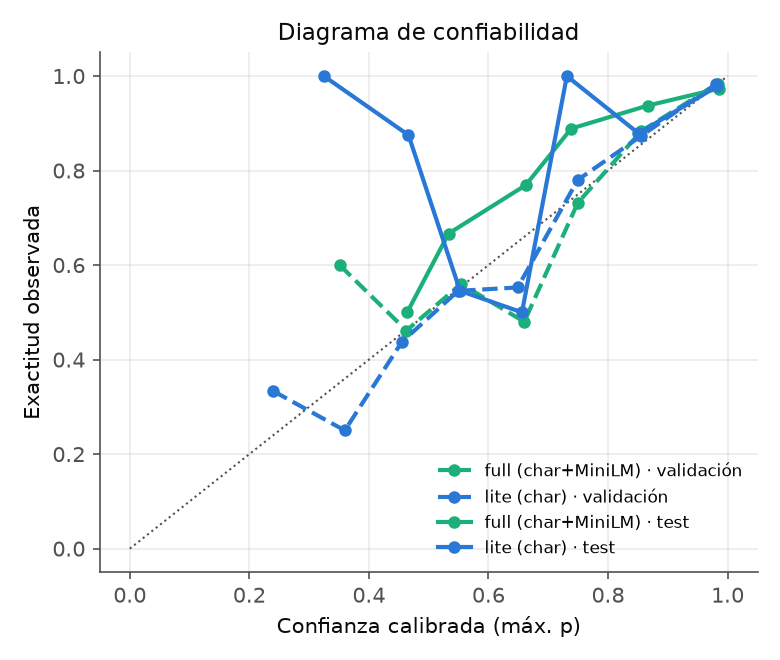

# Router de intención aprendido vs. RuleRouter

> Generado por `scripts/train_intent.py` — no editar a mano. Decisión y justificación: [ADR 0009](../docs/adr/0009-router-aprendido.md). Corpus, guía y anotaciones: [`corpus/intent/`](../corpus/intent/).

- **Aprendido lite (char) — se despliega:** `char2-5-tfidf` + regresión logística (C=30.0, clases balanceadas), temperatura T=0.62, umbral de abstención τ=0.68 (máxima cobertura con acción equivocada ≤ 1% en validación). Artefactos `models/intent_router_lite/` (0.2 MB).
- **Aprendido full (char+MiniLM) — offline:** `char2-5-tfidf+qdrant/paraphrase-multilingual-MiniLM-L12-v2-onnx-Q@faf4aa42` + regresión logística (C=30.0, clases balanceadas), temperatura T=0.68, umbral de abstención τ=0.76 (máxima cobertura con acción equivocada ≤ 1% en validación). Artefactos `models/intent_router_full/` (0.2 MB).
- Corpus de train sha256 `8d3421c48e00014f…`; test congelado en `corpus/intent/MANIFEST.json` (2026-09-29T01:25:19).

## Resumen

| split | métrica | RuleRouter (línea base) | Aprendido lite (char) — se despliega | Aprendido full (char+MiniLM) — offline |
|---|---|---|---|---|
| **test (autores C y G)** | n=306 (152 familias) |  |  |  |
|  | macro-F1, 9 intenciones (IC 95%) | 0.548 [0.473, 0.604] | 0.868 [0.826, 0.902] | 0.904 [0.863, 0.934] |
|  | Δ macro-F1 vs. reglas (IC 95%) | — | +0.321 [0.259, 0.393] | +0.356 [0.296, 0.425] |
|  | macro-F1 por ruta del grafo | 0.571 | 0.839 | 0.882 |
|  | mensajes con acción equivocada | 18.6% (57) | 2.6% (8) | 1.6% (5) |
|  | handoff pedido → se inició disputa | 33 | 3 | 2 |
|  | costo esperado por mensaje (IC 95%) | 0.673 [0.544, 0.820] | 0.126 [0.076, 0.181] | 0.090 [0.044, 0.146] |
|  | cobertura (sin aclarar por baja confianza) | 64.7% | 89.9% | 92.2% |
|  | 5 semillas (85% de familias): macro-F1 | — | 0.849 ± 0.007 | 0.892 ± 0.009 |
| **test de estilo no visto (autor D)** | n=175 (69 familias) |  |  |  |
|  | macro-F1, 9 intenciones (IC 95%) | 0.719 [0.631, 0.783] | 0.878 [0.822, 0.919] | 0.897 [0.842, 0.941] |
|  | Δ macro-F1 vs. reglas (IC 95%) | — | +0.159 [0.086, 0.243] | +0.179 [0.104, 0.274] |
|  | macro-F1 por ruta del grafo | 0.712 | 0.855 | 0.868 |
|  | mensajes con acción equivocada | 1.1% (2) | 0.0% (0) | 0.0% (0) |
|  | handoff pedido → se inició disputa | 1 | 0 | 0 |
|  | costo esperado por mensaje (IC 95%) | 0.211 [0.147, 0.283] | 0.086 [0.055, 0.123] | 0.066 [0.035, 0.101] |
|  | cobertura (sin aclarar por baja confianza) | 58.9% | 90.9% | 92.6% |
|  | 5 semillas (85% de familias): macro-F1 | — | 0.865 ± 0.014 | 0.882 ± 0.011 |
| **CPU, 1 hilo** | latencia de clasificación p50 / p95 (HybridRouter = esto + reglas) | 0.57 / 0.77 ms | 0.20 / 0.28 ms | 14.24 / 21.10 ms |
|  | en disco | 0 MB | 0.2 MB + 0 MB preentrenado | 0.2 MB + 252.1 MB preentrenado |

- Las 9 etiquetas son las intenciones de usuario que el grafo ya maneja (#54); RuleRouter las cubre todas, así que la comparación es directa. RuleRouter se evalúa como lo usa el grafo: confianza < 0.6 → aclarar (`unknown`).
- **Acción equivocada** = el grafo propone una disputa o un bloqueo cuando la ruta correcta era otra (todas las acciones piden confirmación, así que es el error más caro que el router puede provocar).
- **Costo** (`intent_model.error_cost`): aclarar 0.5 · handoff innecesario 1 · handoff a la cola equivocada 0.5 (1 si era toma de cuenta) · consultar estado sin pedirlo 1 · cerrar con un pedido abierto 1.5 · proponer disputa/bloqueo indebido 2, o 3 si el cliente pedía un humano, reportaba robo de cuenta o retiraba un reclamo.
- IC 95% por bootstrap de **familias** de paráfrasis (2000 réplicas): las paráfrasis de una misma idea no son independientes.

## Datos y etiquetas

| intención | train (n=800) | test (n=306) | test_style (n=175) |
|---|---|---|---|
| dispute_charge | 185 | 67 | 46 |
| block_card | 95 | 33 | 23 |
| account_takeover | 62 | 23 | 15 |
| human_request | 69 | 18 | 16 |
| dispute_status | 53 | 38 | 0 |
| cancel_dispute | 48 | 33 | 0 |
| out_of_scope | 174 | 57 | 51 |
| closing | 47 | 17 | 11 |
| unknown | 67 | 20 | 13 |

| dialecto | train | test | test_style |
|---|---|---|---|
| es-MX | 218 | 72 | 43 |
| es-CO | 181 | 58 | 42 |
| es-AR | 160 | 64 | 33 |
| pt-BR | 200 | 82 | 40 |
| mix | 41 | 30 | 17 |

- **Procedencia:** enunciados escritos por el equipo con asistentes de IA, un autor por sesión aislada que solo leyó la [guía de etiquetado](../corpus/intent/GUIA_ETIQUETADO.md) (ni las reglas ni otros archivos del corpus). Split **por autor, fijado antes de escribir**: A, B, E, F → train; C, G → test; D → test de estilo no visto (voz a texto, telegráfico, formal). F y G se sumaron en la v2 de la guía para las intenciones nuevas de #54 (`dispute_status`, `cancel_dispute`); los archivos anteriores no se tocaron y una revisión completa no encontró enunciados viejos que cambiaran de etiqueta (`review/schema_v2_relabel.jsonl` vacío). No hay texto de clientes ni del dataset del organizador (ADR 0003).
- **Validez de etiquetas:** anotaciones ciegas (solo el texto + la guía) comparadas con la etiqueta del autor antes de adjudicar; los desacuerdos se resolvieron en `review/adjudication.jsonl` (o se descartaron por ambiguos). El acuerdo es muy alto: el corpus es *limpio* (ver Limitaciones).

| split · anotador | n | acuerdo | κ de Cohen | desacuerdos | reetiquetados | descartados |
|---|---|---|---|---|---|---|
| train · second | 150 | 98.7% | 0.984 | 2 | 1 | 1 |
| test · second | 233 | 100.0% | 1.000 | 0 | 0 | 0 |
| test_style · second | 185 | 100.0% | 1.000 | 0 | 0 | 0 |
| test · third | 95 | 100.0% | 1.000 | 0 | 0 | 0 |
| test_style · third | 65 | 98.5% | 0.981 | 1 | 0 | 1 |
| train · fourth | 40 | 100.0% | 1.000 | 0 | 0 | 0 |
| test · fourth | 110 | 100.0% | 1.000 | 0 | 0 | 0 |

- **Fuga:** familias de paráfrasis y autores nunca cruzan splits; el vocabulario de n-gramas y la temperatura se ajustan dentro de cada fold; el test no participa de ninguna selección; casi-duplicados de train (Jaccard de trigramas ≥ 0.8, en general saludos o cierres cortos) se sacan del test: 37 en test, 9 en estilo. El script aborta si los hashes congelados del test cambian.

## Selección del componente (solo validación cruzada por autor sobre train)

Cada fold entrena con todos los autores de train menos uno y valida con el que quedó afuera (un autor que el modelo nunca vio, como en el test). Encoder, C, temperatura y umbral salen de acá; el test se evalúa una sola vez al final. Latencia: un mensaje a la vez tras calentar, 1 hilo.

| candidato | macro-F1 | C | T | ECE cruda → calibrada | τ | cobertura | acción equivocada | costo/msg | p50 / p95 ms | MB preentrenado |
|---|---|---|---|---|---|---|---|---|---|---|
| `char` ← lite | 0.865 | 30.0 | 0.62 | 0.114 → 0.013 | 0.68 | 84.0% | 1.0% | 0.122 | 0.20 / 0.28 | 0 |
| `m2v` | 0.818 | 30.0 | 0.87 | 0.042 → 0.020 | 0.81 | 64.8% | 0.9% | 0.196 | 0.18 / 0.21 | 531.0 |
| `minilm` | 0.891 | 30.0 | 0.78 | 0.049 → 0.021 | 0.76 | 84.1% | 1.0% | 0.117 | 13.92 / 20.32 | 252.1 |
| `e5` | 0.856 | 30.0 | 0.57 | 0.148 → 0.025 | 0.81 | 72.5% | 1.0% | 0.170 | 10.27 / 14.71 | 135.4 |
| `char+m2v` | 0.873 | 30.0 | 0.71 | 0.065 → 0.028 | 0.82 | 77.0% | 1.0% | 0.138 | 0.43 / 0.54 | 531.0 |
| `char+minilm` ← full | 0.924 | 30.0 | 0.68 | 0.062 → 0.011 | 0.76 | 88.4% | 1.0% | 0.091 | 14.24 / 21.10 | 252.1 |
| RuleRouter | — |  |  |  |  |  | 9.0% | 0.432 | 0.57 / 0.77 | 0 |

`char` = TF-IDF de n-gramas de caracteres 2–5 aprendido del corpus; `m2v` = model2vec potion-multilingual-128M; `minilm` = paraphrase-multilingual-MiniLM-L12-v2 (ONNX int8); `e5` = multilingual-e5-small (ONNX int8). Regla fijada antes de mirar el test: **full** = mayor macro-F1 en validación (si otro queda a menos de 0.01, el más liviano). **lite** = `char`, el único que entra en el deploy gratuito (512 MB de RAM, 0.1 CPU) sin onnxruntime ni un modelo de 250 MB. Umbral τ: máxima cobertura con acción equivocada ≤ 1% en validación.



## Resultados — test (autores C y G)

|  | Aprendido lite (char) — se despliega | Aprendido full (char+MiniLM) — offline |
|---|---|---|
| ECE (10 bins) | 0.035 | 0.025 |
| macro-F1 sin abstención | 0.928 | 0.956 |
| acción equivocada sin abstención | 3.6% | 3.3% |

### Por intención (precisión / recall / F1)

| intención | soporte | rules P/R/F1 | lite P/R/F1 | full P/R/F1 |
|---|---|---|---|---|
| dispute_charge | 67 | 0.38 / 0.49 / 0.43 | 0.91 / 0.96 / 0.93 | 0.97 / 0.97 / 0.97 |
| block_card | 33 | 0.86 / 0.73 / 0.79 | 0.94 / 0.94 / 0.94 | 0.91 / 0.97 / 0.94 |
| account_takeover | 23 | 0.67 / 0.26 / 0.38 | 1.00 / 0.96 / 0.98 | 1.00 / 0.96 / 0.98 |
| human_request | 18 | 0.68 / 0.72 / 0.70 | 1.00 / 0.94 / 0.97 | 0.94 / 0.94 / 0.94 |
| dispute_status | 38 | 0.92 / 0.29 / 0.44 | 1.00 / 0.58 / 0.73 | 1.00 / 0.66 / 0.79 |
| cancel_dispute | 33 | 0.93 / 0.42 / 0.58 | 1.00 / 0.73 / 0.84 | 1.00 / 0.88 / 0.94 |
| out_of_scope | 57 | 0.92 / 0.21 / 0.34 | 0.94 / 0.89 / 0.92 | 0.96 / 0.91 / 0.94 |
| closing | 17 | 1.00 / 0.94 / 0.97 | 1.00 / 0.94 / 0.97 | 1.00 / 0.94 / 0.97 |
| unknown | 20 | 0.18 / 0.95 / 0.30 | 0.38 / 0.90 / 0.53 | 0.50 / 1.00 / 0.67 |

### Confusión por ruta del grafo

RuleRouter (línea base):

| verdad \ predicción | disputa | bloqueo | estado | handoff | cierre | aclarar |
|---|---|---|---|---|---|---|
| disputa | 33 | 0 | 0 | 6 | 0 | 28 |
| bloqueo | 0 | 24 | 0 | 3 | 0 | 6 |
| estado | 19 | 0 | 11 | 0 | 0 | 8 |
| handoff | 33 | 3 | 1 | 47 | 0 | 47 |
| cierre | 1 | 0 | 0 | 0 | 16 | 0 |
| aclarar | 0 | 1 | 0 | 0 | 0 | 19 |

Aprendido lite (char) — se despliega:

| verdad \ predicción | disputa | bloqueo | estado | handoff | cierre | aclarar |
|---|---|---|---|---|---|---|
| disputa | 64 | 0 | 0 | 0 | 0 | 3 |
| bloqueo | 0 | 31 | 0 | 0 | 0 | 2 |
| estado | 2 | 0 | 22 | 1 | 0 | 13 |
| handoff | 3 | 2 | 0 | 115 | 0 | 11 |
| cierre | 0 | 0 | 0 | 0 | 16 | 1 |
| aclarar | 1 | 0 | 0 | 1 | 0 | 18 |

Aprendido full (char+MiniLM) — offline:

| verdad \ predicción | disputa | bloqueo | estado | handoff | cierre | aclarar |
|---|---|---|---|---|---|---|
| disputa | 65 | 0 | 0 | 1 | 0 | 1 |
| bloqueo | 0 | 32 | 0 | 0 | 0 | 1 |
| estado | 0 | 0 | 25 | 1 | 0 | 12 |
| handoff | 2 | 3 | 0 | 121 | 0 | 5 |
| cierre | 0 | 0 | 0 | 0 | 16 | 1 |
| aclarar | 0 | 0 | 0 | 0 | 0 | 20 |

<details><summary>Matriz de confusión de 9 intenciones (lite)</summary>

| verdad \ predicción | dispute charge | block card | account takeover | human request | dispute status | cancel dispute | out of scope | closing | unknown |
|---|---|---|---|---|---|---|---|---|---|
| dispute charge | 64 | 0 | 0 | 0 | 0 | 0 | 0 | 0 | 3 |
| block card | 0 | 31 | 0 | 0 | 0 | 0 | 0 | 0 | 2 |
| account takeover | 1 | 0 | 22 | 0 | 0 | 0 | 0 | 0 | 0 |
| human request | 0 | 0 | 0 | 17 | 0 | 0 | 1 | 0 | 0 |
| dispute status | 2 | 0 | 0 | 0 | 22 | 0 | 1 | 0 | 13 |
| cancel dispute | 1 | 0 | 0 | 0 | 0 | 24 | 0 | 0 | 8 |
| out of scope | 1 | 2 | 0 | 0 | 0 | 0 | 51 | 0 | 3 |
| closing | 0 | 0 | 0 | 0 | 0 | 0 | 0 | 16 | 1 |
| unknown | 1 | 0 | 0 | 0 | 0 | 0 | 1 | 0 | 18 |

</details>

### Exactitud por autor, dialecto, estilo y negativos difíciles

| corte | grupo | n | rules | lite | full |
|---|---|---|---|---|---|
| autor | C | 203 | 54.7% | 93.1% | 95.1% |
| autor | G | 103 | 35.9% | 73.8% | 82.5% |
| dialecto | es-AR | 64 | 45.3% | 84.4% | 89.1% |
| dialecto | es-CO | 58 | 39.7% | 84.5% | 84.5% |
| dialecto | es-MX | 72 | 47.2% | 86.1% | 88.9% |
| dialecto | mix | 30 | 73.3% | 96.7% | 100.0% |
| dialecto | pt-BR | 82 | 48.8% | 86.6% | 95.1% |
| estilo | chat | 207 | 41.1% | 84.5% | 90.3% |
| estilo | emoji | 7 | 42.9% | 71.4% | 85.7% |
| estilo | formal | 11 | 63.6% | 81.8% | 90.9% |
| estilo | largo | 5 | 60.0% | 80.0% | 80.0% |
| estilo | portunol | 16 | 81.2% | 100.0% | 100.0% |
| estilo | terse | 25 | 80.0% | 96.0% | 96.0% |
| estilo | typos | 24 | 41.7% | 95.8% | 87.5% |
| negativo difícil | False | 230 | 52.6% | 86.1% | 91.3% |
| negativo difícil | True | 76 | 35.5% | 88.2% | 89.5% |

### Errores

**lite**: 41 errores (32 también de reglas). Pares más frecuentes: dispute_status → unknown (13), cancel_dispute → unknown (8), dispute_charge → unknown (3), out_of_scope → unknown (3), block_card → unknown (2), out_of_scope → block_card (2).

**full**: 28 errores (23 también de reglas). Pares más frecuentes: dispute_status → unknown (12), out_of_scope → block_card (3), cancel_dispute → unknown (3), dispute_charge → unknown (1), dispute_charge → human_request (1), block_card → unknown (1).

Errores más confiados de **lite** (los más peligrosos: la abstención no los frena):

| id | dialecto | texto | verdad | lite (p) | reglas |
|---|---|---|---|---|---|
| C-0186 | pt-BR | o app diz que meu cartão tá bloqueado, quero liberar pra usar | out_of_scope | block_card (0.9760000109672546) | block_card |
| C-0202 | es-CO | Nada más, que tenga buen día. | closing | unknown (0.9660000205039978) | closing |
| C-0219 | pt-BR | quanto tá o jogo do Flamengo? | unknown | out_of_scope (0.9639999866485596) | unknown |
| C-0169 | es-AR | qué pasa si desconozco una compra, me devuelven la plata al toque? pregunto nomás | out_of_scope | dispute_charge (0.9559999704360962) | dispute_charge |
| G-0086 | pt-BR | quero cancelar o seguro do cartão | out_of_scope | block_card (0.9549999833106995) | out_of_scope |
| C-0135 | es-AR | cuánto tengo que escribir para que me atienda una persona?? | human_request | out_of_scope (0.890999972820282) | unknown |
| C-0107 | es-CO | alguien entró a mi app y compró cosas con mi tarjeta, no reconozco ninguno de esos cargos | account_takeover | dispute_charge (0.878000020980835) | account_takeover |
| G-0036 | pt-BR | abri uma reclamação do débito duplicado no mercado e até agora nada, como tá isso? | dispute_status | dispute_charge (0.8090000152587891) | unknown |
| G-0063 | es-AR | ey, el cobro de Netflix que desconocí era de la cuenta que comparto con mi hermana, olvidate del reclamo | cancel_dispute | dispute_charge (0.8040000200271606) | dispute_charge |
| G-0029 | es-MX | Buen día. El pasado día 12 presenté una aclaración por un cargo no reconocido de $1,250 en una tienda en línea | dispute_status | out_of_scope (0.6980000138282776) | dispute_charge |
| G-0026 | es-AR | ¿Me confirmás que recibieron el reclamo que hice ayer por el cobro duplicado? | dispute_status | dispute_charge (0.6840000152587891) | dispute_charge |
| C-0218 | pt-BR | me passa uma receita de bolo de cenoura | unknown | dispute_charge (0.6809999942779541) | unknown |

<details><summary>lite acierta y reglas fallan (126) · reglas aciertan y lite falla (9)</summary>

| id | texto | verdad | reglas | lite |
|---|---|---|---|---|
| C-0006 | fui cobrado duas vezes no posto Ipiranga, R$ 230 cada uma | dispute_charge | unknown | dispute_charge |
| C-0007 | el cajero de la 72 con septima no me dio la plata pero si me descontaron 400 mil | dispute_charge | unknown | dispute_charge |
| C-0008 | saque del cajero, no salio el dinero y en la app ya me aparece el retiro de 3000 | dispute_charge | unknown | dispute_charge |
| C-0009 | o caixa eletrônico não soltou as notas e o saque de R$ 500 foi debitado mesmo assim | dispute_charge | unknown | dispute_charge |
| C-0012 | me di de baja del gimnasio y me lo siguen debitando, ya van 2 meses 😡 | dispute_charge | unknown | dispute_charge |
| C-0013 | pagué 38.500 en el restaurante y en el resumen figura 85.300, alguien tipeó mal y quiero que lo corr | dispute_charge | unknown | dispute_charge |
| C-0014 | en Crepes & Waffles pague 96 mil y me cargaron 196 mil, eso no es lo que firmé | dispute_charge | unknown | dispute_charge |
| C-0015 | o valor que caiu na fatura da Drogasil tá errado, era R$ 74 e veio R$ 740 | dispute_charge | unknown | dispute_charge |
| C-0018 | comprei um celular no site da Casas Bahia, não chegou nada e já foi cobrado | dispute_charge | unknown | dispute_charge |
| C-0020 | hola, apareceu un débito de 120 dólares de la aerolínea Azul, yo no compré nada | dispute_charge | unknown | dispute_charge |
| C-0021 | me robaron la billetera y ya hay una compra en un Oxxo que no hice | dispute_charge | unknown | dispute_charge |
| C-0022 | me robaron la tarjeta en el Transmilenio y ya aparece un cargo de 250 mil en el Éxito | dispute_charge | unknown | dispute_charge |
| C-0082 | necesito hacer block de mi card, la perdí en el Uber | block_card | block_card | unknown |
| C-0107 | alguien entró a mi app y compró cosas con mi tarjeta, no reconozco ninguno de esos cargos | account_takeover | account_takeover | dispute_charge |
| C-0202 | Nada más, que tenga buen día. | closing | closing | unknown |
| C-0218 | me passa uma receita de bolo de cenoura | unknown | unknown | dispute_charge |
| C-0219 | quanto tá o jogo do Flamengo? | unknown | unknown | out_of_scope |
| G-0009 | Buenas tardes, quisiera consultar el estado de la disputa que radiqué el lunes por un cobro de Rappi | dispute_status | dispute_status | unknown |
| G-0060 | ya me devolvieron la plata directamente, anulen el reclamo porfa | cancel_dispute | cancel_dispute | unknown |
| G-0085 | quiero cancelar la transferencia que hice recién, me equivoqué de CBU | out_of_scope | out_of_scope | unknown |
| G-0086 | quero cancelar o seguro do cartão | out_of_scope | out_of_scope | block_card |

</details>

## Resultados — test de estilo no visto (autor D)

|  | Aprendido lite (char) — se despliega | Aprendido full (char+MiniLM) — offline |
|---|---|---|
| ECE (10 bins) | 0.026 | 0.026 |
| macro-F1 sin abstención | 0.934 | 0.942 |
| acción equivocada sin abstención | 1.7% | 0.0% |

### Por intención (precisión / recall / F1)

| intención | soporte | rules P/R/F1 | lite P/R/F1 | full P/R/F1 |
|---|---|---|---|---|
| dispute_charge | 46 | 0.97 / 0.72 / 0.82 | 1.00 / 0.74 / 0.85 | 1.00 / 0.76 / 0.86 |
| block_card | 23 | 0.94 / 0.74 / 0.83 | 1.00 / 0.96 / 0.98 | 1.00 / 0.96 / 0.98 |
| account_takeover | 15 | 1.00 / 0.53 / 0.70 | 1.00 / 0.87 / 0.93 | 1.00 / 0.93 / 0.97 |
| human_request | 16 | 1.00 / 0.81 / 0.90 | 1.00 / 0.94 / 0.97 | 1.00 / 1.00 / 1.00 |
| dispute_status | 0 | 0.00 / 0.00 / 0.00 | 0.00 / 0.00 / 0.00 | 0.00 / 0.00 / 0.00 |
| cancel_dispute | 0 | 0.00 / 0.00 / 0.00 | 0.00 / 0.00 / 0.00 | 0.00 / 0.00 / 0.00 |
| out_of_scope | 51 | 1.00 / 0.35 / 0.52 | 0.87 / 0.90 / 0.88 | 0.92 / 0.92 / 0.92 |
| closing | 11 | 0.92 / 1.00 / 0.96 | 1.00 / 0.91 / 0.95 | 1.00 / 0.91 / 0.95 |
| unknown | 13 | 0.18 / 1.00 / 0.31 | 0.43 / 0.92 / 0.59 | 0.44 / 0.92 / 0.60 |

### Confusión por ruta del grafo

RuleRouter (línea base):

| verdad \ predicción | disputa | bloqueo | estado | handoff | cierre | aclarar |
|---|---|---|---|---|---|---|
| disputa | 33 | 0 | 0 | 0 | 0 | 13 |
| bloqueo | 0 | 17 | 0 | 0 | 0 | 6 |
| estado | 0 | 0 | 0 | 0 | 0 | 0 |
| handoff | 1 | 1 | 0 | 39 | 1 | 40 |
| cierre | 0 | 0 | 0 | 0 | 11 | 0 |
| aclarar | 0 | 0 | 0 | 0 | 0 | 13 |

Aprendido lite (char) — se despliega:

| verdad \ predicción | disputa | bloqueo | estado | handoff | cierre | aclarar |
|---|---|---|---|---|---|---|
| disputa | 34 | 0 | 0 | 5 | 0 | 7 |
| bloqueo | 0 | 22 | 0 | 0 | 0 | 1 |
| estado | 0 | 0 | 0 | 0 | 0 | 0 |
| handoff | 0 | 0 | 0 | 74 | 0 | 8 |
| cierre | 0 | 0 | 0 | 1 | 10 | 0 |
| aclarar | 0 | 0 | 0 | 1 | 0 | 12 |

Aprendido full (char+MiniLM) — offline:

| verdad \ predicción | disputa | bloqueo | estado | handoff | cierre | aclarar |
|---|---|---|---|---|---|---|
| disputa | 35 | 0 | 0 | 3 | 0 | 8 |
| bloqueo | 0 | 22 | 0 | 0 | 0 | 1 |
| estado | 0 | 0 | 0 | 0 | 0 | 0 |
| handoff | 0 | 0 | 0 | 77 | 0 | 5 |
| cierre | 0 | 0 | 0 | 0 | 10 | 1 |
| aclarar | 0 | 0 | 0 | 1 | 0 | 12 |

<details><summary>Matriz de confusión de 9 intenciones (lite)</summary>

| verdad \ predicción | dispute charge | block card | account takeover | human request | dispute status | cancel dispute | out of scope | closing | unknown |
|---|---|---|---|---|---|---|---|---|---|
| dispute charge | 34 | 0 | 0 | 0 | 0 | 0 | 5 | 0 | 7 |
| block card | 0 | 22 | 0 | 0 | 0 | 0 | 0 | 0 | 1 |
| account takeover | 0 | 0 | 13 | 0 | 0 | 0 | 0 | 0 | 2 |
| human request | 0 | 0 | 0 | 15 | 0 | 0 | 0 | 0 | 1 |
| dispute status | 0 | 0 | 0 | 0 | 0 | 0 | 0 | 0 | 0 |
| cancel dispute | 0 | 0 | 0 | 0 | 0 | 0 | 0 | 0 | 0 |
| out of scope | 0 | 0 | 0 | 0 | 0 | 0 | 46 | 0 | 5 |
| closing | 0 | 0 | 0 | 0 | 0 | 0 | 1 | 10 | 0 |
| unknown | 0 | 0 | 0 | 0 | 0 | 0 | 1 | 0 | 12 |

</details>

### Exactitud por autor, dialecto, estilo y negativos difíciles

| corte | grupo | n | rules | lite | full |
|---|---|---|---|---|---|
| autor | D | 175 | 64.6% | 86.9% | 89.1% |
| dialecto | es-AR | 33 | 57.6% | 90.9% | 97.0% |
| dialecto | es-CO | 42 | 71.4% | 83.3% | 83.3% |
| dialecto | es-MX | 43 | 60.5% | 90.7% | 88.4% |
| dialecto | mix | 17 | 100.0% | 82.4% | 94.1% |
| dialecto | pt-BR | 40 | 52.5% | 85.0% | 87.5% |
| estilo | formal | 47 | 61.7% | 78.7% | 83.0% |
| estilo | terse | 59 | 61.0% | 86.4% | 84.7% |
| estilo | voz | 69 | 69.6% | 92.8% | 97.1% |
| negativo difícil | False | 154 | 70.1% | 85.1% | 87.7% |
| negativo difícil | True | 21 | 23.8% | 100.0% | 100.0% |

### Errores

**lite**: 23 errores (11 también de reglas). Pares más frecuentes: dispute_charge → unknown (7), dispute_charge → out_of_scope (5), out_of_scope → unknown (5), account_takeover → unknown (2), block_card → unknown (1), human_request → unknown (1).

**full**: 19 errores (9 también de reglas). Pares más frecuentes: dispute_charge → unknown (8), out_of_scope → unknown (4), dispute_charge → out_of_scope (3), block_card → unknown (1), account_takeover → unknown (1), closing → unknown (1).

Errores más confiados de **lite** (los más peligrosos: la abstención no los frena):

| id | dialecto | texto | verdad | lite (p) | reglas |
|---|---|---|---|---|---|
| D-0164 | es-MX | cuál es la capital de Perú | unknown | out_of_scope (0.996999979019165) | unknown |
| D-0143 | es-MX | Agradezco su atención; no requiero nada más por el momento. Quedo atento. | closing | out_of_scope (0.8880000114440918) | closing |
| D-0134 | mix | hola eh queria saber si tengo seguro de vida no cartão ou como contrato um | out_of_scope | unknown (0.8519999980926514) | out_of_scope |
| D-0003 | es-MX | Estimados, por medio de la presente manifiesto que no reconozco el cargo por trescientos cincuenta pesos aplic | dispute_charge | out_of_scope (0.8450000286102295) | dispute_charge |
| D-0033 | es-CO | Cordialmente solicito la revisión de un cobro superior al valor acordado en un establecimiento hotelero, con u | dispute_charge | out_of_scope (0.8240000009536743) | dispute_charge |
| D-0032 | es-CO | monto distinto al pagado | dispute_charge | out_of_scope (0.7680000066757202) | unknown |
| D-0024 | es-AR | Estimados, me dirijo a ustedes para impugnar un consumo por nueve mil pesos correspondiente a un pedido cancel | dispute_charge | out_of_scope (0.7200000286102295) | unknown |
| D-0030 | es-MX | Solicito respetuosamente la aclaración de dos cargos idénticos por mil doscientos pesos efectuados en el mismo | dispute_charge | out_of_scope (0.6850000023841858) | dispute_charge |
| D-0011 | pt-BR | compra não chegou | dispute_charge | unknown (0.6209999918937683) | unknown |
| D-0021 | es-CO | Respetados señores, desconozco la transacción por ciento cuarenta mil pesos realizada en Medellín, ciudad en l | dispute_charge | unknown (0.6069999933242798) | dispute_charge |
| D-0130 | es-CO | queja por mal servicio | out_of_scope | unknown (0.6010000109672546) | unknown |
| D-0080 | pt-BR | caí num golpe de phishing | account_takeover | unknown (0.597000002861023) | unknown |

<details><summary>lite acierta y reglas fallan (51) · reglas aciertan y lite falla (12)</summary>

| id | texto | verdad | reglas | lite |
|---|---|---|---|---|
| D-0007 | mirá che tipo estaba en el cajero de la calle corrientes no perdón en el de avenida cabildo y puse l | dispute_charge | unknown | dispute_charge |
| D-0008 | cajero no dio plata | dispute_charge | unknown | dispute_charge |
| D-0017 | me siguen cobrando | dispute_charge | unknown | dispute_charge |
| D-0029 | dos cargos iguales | dispute_charge | unknown | dispute_charge |
| D-0034 | mirá yo no sé qué es esto pero me aparece un débito de una app de juegos que jamás instalé por cuatr | dispute_charge | unknown | dispute_charge |
| D-0038 | valor cobrado errado | dispute_charge | unknown | dispute_charge |
| D-0042 | me robaron la tarjeta y ya vi que con ella hicieron una compra de dos mil pesos en gasolinera que yo | dispute_charge | unknown | dispute_charge |
| D-0053 | Cordial saludo, solicito el bloqueo de mi tarjeta crédito por hurto del bolso. | block_card | unknown | block_card |
| D-0060 | meu filho mexeu na minha carteira e acho que o cartão sumiu talvez esteja em casa mas por segurança  | block_card | unknown | block_card |
| D-0061 | cancelar cartão | block_card | unknown | block_card |
| D-0062 | Prezados, por segurança solicito o cancelamento do meu cartão, que não localizo desde ontem. | block_card | unknown | block_card |
| D-0063 | oye una duda ya no voy a usar esta tarjeta la que tiene el chip roto o sea la vieja quiero cancelarl | block_card | unknown | block_card |
| D-0003 | Estimados, por medio de la presente manifiesto que no reconozco el cargo por trescientos cincuenta p | dispute_charge | dispute_charge | out_of_scope |
| D-0019 | parce imagínese que estaba mirando el extracto y hay un pago en una tienda de Medellín por ciento cu | dispute_charge | dispute_charge | unknown |
| D-0021 | Respetados señores, desconozco la transacción por ciento cuarenta mil pesos realizada en Medellín, c | dispute_charge | dispute_charge | unknown |
| D-0030 | Solicito respetuosamente la aclaración de dos cargos idénticos por mil doscientos pesos efectuados e | dispute_charge | dispute_charge | out_of_scope |
| D-0033 | Cordialmente solicito la revisión de un cobro superior al valor acordado en un establecimiento hotel | dispute_charge | dispute_charge | out_of_scope |
| D-0036 | Estimados: desconozco un débito mensual de cuatro mil pesos de una aplicación de juegos; solicito su | dispute_charge | dispute_charge | unknown |
| D-0067 | uy me parece que alguien me vio digitar la clave en el cajero y ahora tengo miedo entonces mejor blo | block_card | block_card | unknown |
| D-0083 | acceso no autorizado | account_takeover | account_takeover | unknown |
| D-0134 | hola eh queria saber si tengo seguro de vida no cartão ou como contrato um | out_of_scope | out_of_scope | unknown |
| D-0135 | seguros | out_of_scope | out_of_scope | unknown |
| D-0143 | Agradezco su atención; no requiero nada más por el momento. Quedo atento. | closing | closing | out_of_scope |
| D-0164 | cuál es la capital de Perú | unknown | unknown | out_of_scope |

</details>

## Calibración

Temperatura ajustada por NLL en las predicciones fuera de fold; ECE con 10 bins de igual ancho.

| sistema | ECE validación cruda → calibrada | ECE test | ECE test_style |
|---|---|---|---|
| lite | 0.114 → 0.013 | 0.035 | 0.026 |
| full | 0.062 → 0.011 | 0.025 | 0.026 |



## Limitaciones

- El corpus lo escribieron asistentes de IA siguiendo una guía: es más limpio y prototípico que el tráfico real (de ahí el acuerdo casi perfecto entre anotadores). Los números absolutos son optimistas; el test de estilo no visto y la evaluación de punta a punta (`reports/eval.md`) son la referencia más realista.
- RuleRouter se ajustó en #54 con el split dev de `evals/cases` y con frases propias, no con este corpus; aun así, nadie ajustó las reglas mirando el test C/D/G.
- La guía da precedencia a disputa sobre pedido de humano ("quiero hablar con alguien por un cargo que no hice" = `dispute_charge`); RuleRouter hace lo contrario a propósito (#54). Esos casos cuentan como error de reglas aunque sean una decisión de diseño: son pocos (fila *disputa → handoff* de su matriz por ruta).
- `dispute_status` y `cancel_dispute` tienen un solo autor de train (F): es donde más se abstiene el modelo (pasa a aclarar, no a una acción). Más autores para esas dos intenciones es la mejora más barata.
- El mejor C quedó en el borde de la grilla (30) para todos los candidatos; no se amplió después de ver el test.
- n chico por intención (≈20–60 en test): por eso los IC por bootstrap de familias.

## Reproducir

```bash
pip install -e ".[ml,ml-train]"
PYTHONPATH=src python scripts/train_intent.py   # CPU, minutos; baja los modelos preentrenados a la caché de Hugging Face la primera vez
```

Python 3.12.2 · AMD64 · Intel64 Family 6 Model 165 Stepping 2, GenuineIntel · numpy 2.5.3 · scikit-learn 1.9.1.

